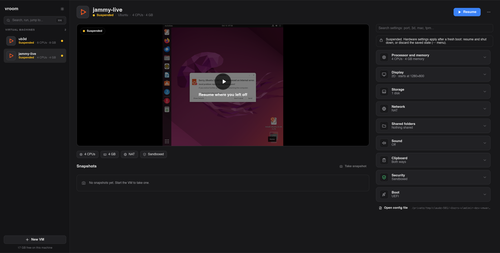

# vroom-vroom

Run Linux and Windows VMs on your Mac (Apple Silicon) or on arm64 Linux.
Written in Rust. The VM process locks itself down before the guest starts,
and every virtual device treats the guest as hostile.



## What works

- Ubuntu, Debian, Alpine, Windows 11 ARM64
- Window with clipboard both ways and auto resolution
- 3D for Linux guests: Vulkan (about 90% of native speed) and OpenGL
- Snapshots, suspend/resume, reset
- NAT with port forwards, several network adapters. Bridged and host-only need a root helper.
- Sound in Linux and Windows guests; microphone if you turn it on
- Shared folders (Linux and Windows guests)
- TPM 2.0 (Windows 11 needs it)
- Nested VMs (M3 or newer)
- Import from VMware Fusion (ARM64 VMs)
- USB devices from the host (those macOS has no driver for; needs libusb)

Not yet: x86_64 hosts (it builds, can't run VMs yet), Secure Boot, and
3D in Windows guests.

## Try it

```bash
brew install qemu            # only for its UEFI firmware file
scripts/build.sh --release   # builds and signs vroom + vroom-gui
target/release/vroom-gui     # the app: New VM, pick the ISO, Start
```

Or from the terminal:

```bash
target/release/vroom new dev --os linux --disk 32G --iso ubuntu-24.04-desktop-arm64.iso
target/release/vroom-gui dev.toml
```

Ubuntu installs like on a real machine. Windows needs a few more steps:
[docs/GUIDE.md](docs/GUIDE.md#windows-11-arm64).

## Cheat sheet

```bash
vroom-gui                         # the app: VM list, settings, snapshots
vroom-gui dev.toml                # open one VM in a window
vroom run dev.toml                # no window: serial console in this terminal
vroom check dev.toml              # validate a config, print it with defaults
vroom new NAME --os linux|windows --disk 64G --iso FILE
vroom import ~/Virtual\ Machines.localized/X.vmwarevm   # from VMware Fusion
vroom snapshot list|delete|prune dev.toml
vroom disk create x.qcow2 --size 64G
vroom disk compact x.qcow2        # give freed space back to the host
vroom usb list                    # host USB devices, the id for [[usb]]
```

| In the VM window | Keys |
|---|---|
| snapshot / suspend / pause | `Ctrl+Alt+Shift` + `S` / `Z` / `P` |
| reset / shut down / power off | `Ctrl+Alt+Shift` + `R` / `D` / `Q` |
| toolbar | move the mouse to the top edge |
| close the window | suspends the VM, next start resumes it |

| In `vroom run` | `Ctrl-A` then |
|---|---|
| power off / shut down / suspend | `x` / `d` / `z` |
| snapshot / pause / reset | `s` / `p` / `r` |
| clipboard to / from guest, screenshot | `c` / `v` / `g` |

In the app: `⌘K` finds VMs, actions and settings. Drop an ISO on the
window to make a VM from it.

A VM is one TOML file. The app edits the same file and keeps your
comments:

```toml
name = "dev"
cpus = 4
memory_mib = 4096

[boot]
type = "uefi"
vars = "dev.state/efivars.fd"

[[disk]]
path = "dev.qcow2"

[[net]]
mode = "nat"
port_forwards = [{ host_port = 2222, guest_port = 22 }]

[display]
gpu = "virtio2d"
```

## Docs

- [GUIDE.md](docs/GUIDE.md): install Ubuntu and Windows, 3D, shares, sound, disks
- [CONFIG.md](docs/CONFIG.md): every config option
- [NETWORKING.md](docs/NETWORKING.md): NAT, bridged, host-only
- [SECURITY.md](docs/SECURITY.md): what is isolated and how, known gaps
- [ARCHITECTURE.md](docs/ARCHITECTURE.md): how the code is laid out
- [PERFORMANCE.md](docs/PERFORMANCE.md): numbers against QEMU, how to measure

Apache-2.0.
