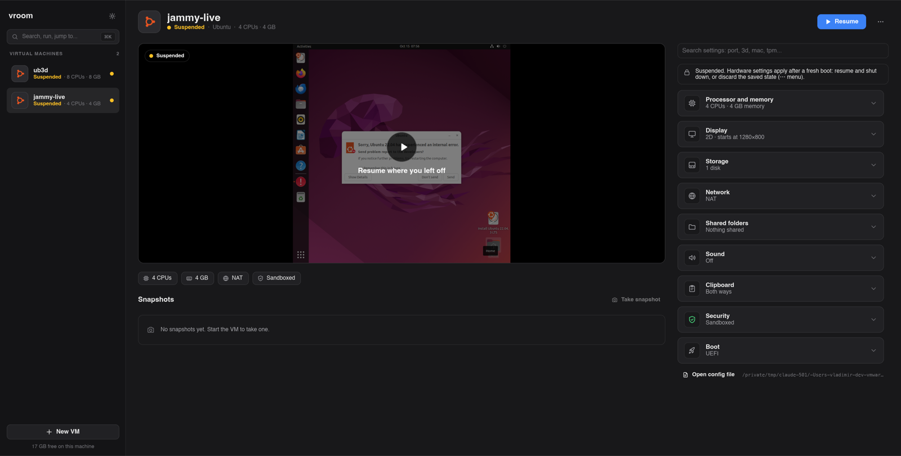

# vroom-vroom

Linux and Windows VMs on Apple Silicon Macs and arm64 Linux. Rust. The VMM sandboxes itself before the guest starts; every device treats the guest as hostile.



## Security

- VMM in Rust, sandboxed
- GPU in a separate sandboxed process
- shared memory per VM
- guest code can't reach your files, other apps or the network stack

```text
 ┌──────────────────────────── your Mac ─────────────────────────────┐
 │                                                                   │
 │   ┌───────────┐                                                   │
 │   │ vroom-gui │◄──── window · keyboard · clipboard · drops        │
 │   └─────┬─────┘                                                   │
 │         │                                                         │
 │   ╔═════╧═══════════════ VMM ════════════════╗                    │
 │   ║                                          ╟──── disks          │
 │   ║   ┌──────────── guest ──────────────┐    ╟──── shared folders │
 │   ║   │  Linux / Windows      (hostile) │    ╟──── NAT            │
 │   ║   └─────────────────────────────────┘    ║                    │
 │   ╚═╤═══════╤═══════╤═══════╤═══════╤═══════╤╝                    │
 │     │       │       │       │       │       │                     │
 │  ╔══╧═══╗╔══╧═══╗╔══╧═══╗╔══╧═══╗╔══╧═══╗╔══╧═══╗  ┌──────────┐   │
 │  ║  3D  ║║audio ║║camera║║video ║║ USB  ║║ TPM  ║  │   netd   │   │
 │  ╚══╤═══╝╚══╤═══╝╚══╤═══╝╚══╤═══╝╚══╤═══╝╚══════╝  │  (root)  │   │
 │  ╔══╧═══╗ sound  camera  codecs  device            └────┬─────┘   │
 │  ║ apps ║ (mic)                                        LAN        │
 │  ╚══╤═══╝                                                         │
 │    GPU                                                            │
 └───────────────────────────────────────────────────────────────────┘
   ═══ own sandbox     ─── no sandbox     camera, mic, video: opt-in
```

- Guest breakout lands in the VMM sandbox: its own disks, nothing else.
- One 3D process per guest Vulkan or Direct3D app; one each for video decode and encode.
- Details: [SECURITY.md](docs/SECURITY.md).

## What works

- Ubuntu, Debian, Alpine, Windows 11 ARM64
- clipboard both ways, auto resolution, sharp on Retina
- 3D: Linux guests Vulkan 1.3 (~90% of native, windowed too) and OpenGL 4.1; OpenGL 4.4 per app via Zink; Windows guests Direct3D 11 and OpenGL 4.1
- Coherence: Windows and Linux (X11) apps as Mac windows
- snapshots, suspend/resume, reset
- NAT with port forwards, several adapters; bridged and host-only with DHCP (Mac ↔ VMs ↔ VMs) via a root helper (one password prompt)
- sound; microphone and camera opt-in
- shared folders (Linux, Windows)
- TPM 2.0, Secure Boot (Windows 11 wants both)
- nested VMs (M3+)
- import from VMware Fusion (ARM64)
- USB passthrough, live from the VM window; USB disks also as shared files or a plain disk
- drag and drop files both ways
- up to 4 guest monitors, full screen across Mac screens
- Linux guests, opt-in: hardware video decode (H.264, HEVC, VP9, AV1), encode (H.264, HEVC); Firefox, Chrome, FFmpeg use them
- disk and network I/O measured against QEMU: [PERFORMANCE.md](docs/PERFORMANCE.md)

Not yet: x86_64 hosts (builds, can't run VMs).

## Build

```bash
xcodebuild -downloadComponent MetalToolchain
brew install qemu meson ninja bison pkg-config llvm llvm@15 molten-vk lld uv
cargo install cargo-xwin
scripts/app.sh --install     # vroom.app with 3D and guest tools, in /Applications
```

First build fetches and builds the 3D libraries and Windows drivers: ~1 h. Later builds redo only what changed.

App: New VM → Ubuntu (downloaded for you) or a Windows 11 ARM64 ISO: comes up installed, with guest tools. Any installer ISO works.

Terminal:

```bash
scripts/build.sh --release   # builds and signs vroom + vroom-gui
target/release/vroom new dev --os linux --disk 32G --iso ubuntu-24.04-desktop-arm64.iso
target/release/vroom-gui dev.toml
```

Windows by hand: [GUIDE.md](docs/GUIDE.md#windows-11-arm64).

## Cheat sheet

```bash
vroom-gui                         # the app: VM list, settings, snapshots
vroom-gui dev.toml                # one VM in a window
vroom run dev.toml                # no window: serial console in this terminal
vroom check dev.toml              # validate a config, print it with defaults
vroom new NAME --os linux|windows --disk 64G --iso FILE
vroom new NAME --os ubuntu|windows --ready [--iso WIN.iso] --ssh-key ~/.ssh/id_ed25519.pub
vroom guest-tools info            # the guest tools this vroom has
vroom import ~/Virtual\ Machines.localized/X.vmwarevm   # from VMware Fusion
vroom snapshot list|delete|prune dev.toml
vroom disk create x.qcow2 --size 64G
vroom disk compact x.qcow2        # give freed space back to the host
vroom usb list                    # host USB devices, the id for [[usb]]
vroom net                         # host-only networks, each running VM's address
```

| VM window | Keys |
|---|---|
| snapshot / suspend / pause | `Ctrl+Alt+Shift` + `S` / `Z` / `P` |
| reset / shut down / power off | `Ctrl+Alt+Shift` + `R` / `D` / `Q` |
| Coherence | `Ctrl+Alt+Shift` + `C` |
| toolbar in full screen | mouse to the top edge |
| close the window | suspends; next start resumes |

| `vroom run` | `Ctrl-A` then |
|---|---|
| power off / shut down / suspend | `x` / `d` / `z` |
| snapshot / pause / reset | `s` / `p` / `r` |
| clipboard to / from guest, screenshot | `c` / `v` / `g` |

App: `⌘K` for VMs, actions, settings. Drop an ISO to make a VM.

A VM is one TOML file. The app edits it in place, keeping comments:

```toml
name = "dev"
cpus = 4
memory_mib = 4096

[boot]
type = "uefi"
vars = "dev.state/efivars.fd"

[[disk]]
path = "dev.qcow2"

[[net]]
mode = "nat"
port_forwards = [{ host_port = 2222, guest_port = 22 }]

[display]
gpu = "virtio2d"
```

## Docs

| | |
|---|---|
| [GUIDE.md](docs/GUIDE.md) | install Ubuntu and Windows, 3D, shares, sound, disks |
| [CONFIG.md](docs/CONFIG.md) | every config option |
| [NETWORKING.md](docs/NETWORKING.md) | NAT, bridged, host-only |
| [SECURITY.md](docs/SECURITY.md) | what is isolated and how, known gaps |
| [ARCHITECTURE.md](docs/ARCHITECTURE.md) | code layout |
| [PERFORMANCE.md](docs/PERFORMANCE.md) | numbers against QEMU, how to measure |

Apache-2.0.
