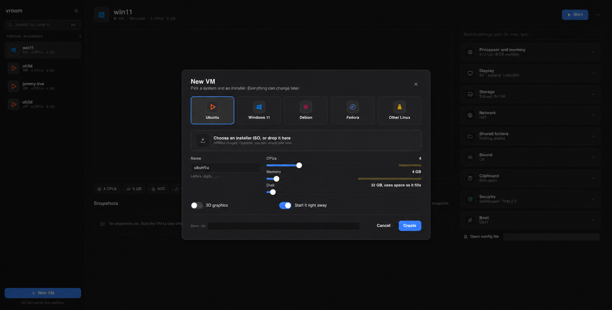

# Guide

## Prerequisites (macOS, Apple Silicon)

```bash
brew install qemu            # only for the EDK2 firmware files and qemu-img
scripts/app.sh --install     # vroom.app, in /Applications
```

`qemu` is not used to run anything: vroom only reads
`/opt/homebrew/share/qemu/edk2-aarch64-code.fd` (UEFI) from it.
`scripts/build.sh` builds just the two programs, in `target/debug`
(`--release`: `target/release`), for use from the terminal.

## The Mac app

`scripts/app.sh` builds `target/dist/vroom.app`; `--install` also copies
it to `/Applications` (it refuses while VMs run from the copy there).
You can also drag it there yourself. Then vroom starts like any Mac app:
from Finder, Launchpad, Spotlight, or the Dock once you keep it there.

Build the 3D libraries before the app if you want 3D in its VMs
(`scripts/build-virglrenderer.sh`, then `scripts/build-dxmt.sh` for
Windows guests, see below). `app.sh` puts whatever was built in the app.

What it does that the bare `vroom-gui` doesn't:

- Open a VM file with it (right-click, Open With, vroom, or drop it on
  the Dock icon): the VM starts, as with `vroom-gui vm.toml`. vroom
  doesn't make itself the default app for `.toml` files; to double-click
  VM files, pick vroom in Finder's Get Info, "Open with", for that file.
- Drop an ISO on the Dock icon: New VM, with that installer. A VMware VM
  (`.vmwarevm`): the import.
- Camera and microphone questions name vroom, not Terminal.
- Its own messages go to `~/Library/Application Support/vroom/logs/vroom-gui.log`
  (there is no terminal to print to). Each VM's last run log is in
  `logs/` there too (`⋯` → Show log).

The terminal still works: `/Applications/vroom.app/Contents/MacOS/vroom`
is the VMM with all its commands (a symlink to it in your `PATH` is fine).

Inside the app:

```text
vroom.app/Contents/
  MacOS/vroom-gui        the app
  MacOS/vroom            the VMM, started by the app
  Frameworks/*.dylib     3D: virglrenderer, MoltenVK, DXMT, ANGLE
  Resources/vroom.icns   the icon (packaging/macos/)
  Info.plist             packaging/macos/Info.plist
```

The app is signed ad hoc: the VMM with the hypervisor entitlement, then
the bundle. That is enough on the Mac that built it. It isn't enough to
give it to other people: their Mac blocks it ("not from an identified
developer") until they allow it in System Settings, Privacy & Security.
A proper release needs an Apple Developer ID certificate, signing with
the hardened runtime (and then the camera and microphone entitlements,
`com.apple.security.device.camera` and `...device.audio-input`, next to
the hypervisor one), and Apple's notarization. None of that is set up.

macOS remembers the camera and microphone answers for the app's
signature. An ad hoc signature changes with each build, so after a
rebuild macOS may ask again.

## The app

`vroom-gui` with no arguments opens the app.



- New VMs go in `~/Library/Application Support/vroom/VMs/<name>/` (Linux:
  `~/.local/share/vroom/VMs/`). "Add existing" takes any VM file; it stays
  where it is.
- Settings are saved to the VM file right away. Comments and layout in the
  file are kept. Hand edits show up in the app within a couple of seconds.
- A running or suspended VM's hardware is locked: CPUs, memory, disks,
  display, shared folders, sound, security, boot. Each locked card has a
  lock; hover it for why. Network adapters and USB devices change right away on a VM
  running in the app (or when a suspended one resumes); what has to
  wait for the next start says so in its card. Clipboard rules apply
  right away.
- The app keeps text short: labels, icons and colors on screen. Hover a
  setting, a button or a choice (or reach it with Tab) for what it does
  and its key in the file. Every option is in
  [CONFIG.md](CONFIG.md); the rare ones are under "Advanced" in each card.
- `⌘K` (Ctrl+K on Linux): start, suspend, snapshot, jump to a setting.
- Each VM's last run log: `⋯` → Show log.
- The app only reads pictures it saved itself (VM screens, snapshot
  thumbnails, under `.../vroom/thumbs/`), never files from a state dir:
  the sandboxed VMM can write there.
- `VROOM_HOME=dir` uses another data dir. `VROOM_SHOT=out.png` saves a
  picture of the window and quits (that's how the README pictures are made).

### The VM window

A bar along the top of the window holds the VM's name and state, then
pause, snapshot, suspend, the power menu (shut down, restart, force power
off) and, for Windows, Ctrl+Alt+Del. On the right: how busy the VM is
(the host CPU time it uses, out of what its CPUs could use), "3D" or
"Direct3D 11" when 3D is on, the network adapters (see
[Network adapters](#network-adapters)), USB devices (see [USB devices](#usb-devices)),
Coherence (below), the settings (the VM's page in the app),
full screen, and the VM list. The guest gets the rest of the window: a
guest with the agent takes exactly that size. In full screen the bar
goes away and slides in when the mouse touches the top edge.

The mouse pointer over the guest is one pointer, the guest's:

- A guest that hands its pointer to the GPU (Linux desktops that use the
  hardware cursor) gets the Mac's pointer drawn with the guest's picture,
  as in VMware. When the guest hides it, it's hidden.
- Windows draws its pointer into the screen picture itself (its virtio-gpu
  drivers, 2D and 3D, have no hardware pointer). Over a Windows guest the
  Mac's pointer hides and Windows' own shows, as fast as the guest draws.
  It's hidden during boot too, when Windows shows none.
- Any other guest that gives no pointer keeps the Mac's arrow.

### Drag and drop

Drag files or folders from Finder onto the VM window to copy them into
the guest. Needs the guest tools (the agent) of this version or later.

- **Windows:** the drop lands wherever you let go, as if you had dragged
  the files inside Windows: into an Explorer folder, onto the desktop, into
  a mail as an attachment, onto an app. While you hover, Windows shows
  its own drag picture and "Copy to Documents".
- **Linux, X11 desktops** (Ubuntu's GNOME on Xorg, Xfce, KDE on X11):
  the same, a real drag in the guest: drop into a Files window, onto the
  desktop, into a browser. (An empty folder's "Folder is Empty" page in
  GNOME Files takes no drops; drop on the folder's icon instead.)
- **Linux, Wayland:** a program outside the desktop can't start a drag
  there, so the files go to the Desktop (a name that is taken gets a
  number: `photo (2).jpg`), and the desktop shows a notification.

While the files hover, the window's edge lights up and a line at the
bottom says what a drop does (or why the guest can't take them: no guest
tools, nobody logged in). Nothing reaches the guest until you drop: only
the names, so it can get ready. Then a bar shows the copy's progress.

Names Windows can't take (`:` `?` `*` and the like) get a `_` instead.
Links inside dropped folders are left out.

The other way works too: drag files or folders from the guest (Explorer,
the Windows desktop, GNOME Files or the desktop on X11) out of the VM
window and drop them in Finder, on the Mac's desktop or into a Mac app
that takes files. Nothing is copied while you drag: the files come from
the guest when you drop, and a bar in the VM window shows how far the
copy is. A name that is taken where you drop gets a number, the way
Finder does it (`report 2.pdf`); nothing is overwritten. The copy stops
if the Mac's disk would have less than 2 GB free. A file the guest
can't read (open in another app with a lock) fails the copy with its
name. Not on Wayland guests (the desktop keeps its drags to itself), and
only files that are real files in the guest (not what is inside a zip
in Explorer, nor attachments dragged from a mail app). Mac apps that
only take files that exist already (Terminal, some editors) get nothing:
drop in Finder first.

### Coherence

Coherence shows each guest app as a window of its own on your Mac,
without the guest's desktop and taskbar around it. VMware calls it Unity.
It works with Windows guests and with Linux guests in an X11 session.
Needs the guest tools of this version or later.

- Turn it on with the window button in the VM's bar, or
  `Ctrl+Alt+Shift+C`. The VM window goes away; each guest window gets a
  Mac window where it was on the guest's screen.
- The guest's screen takes the size of your Mac screen (less the menu bar,
  the Dock and the bar below), so a maximized app fills the screen.
- Every such window has a thin strip on top with the VM's name and the
  window's title. Drag the strip to move the window; drag its edges to
  resize it. The guest app follows. Moving it by its own title bar works
  too.
- A bar at the bottom stands in for the taskbar: **Start** opens the Start
  menu, a field to open an app by name, then one button per app window
  with its icon (minimized ones too: click to bring one back), and
  **Leave Coherence**. The bar can be dragged anywhere.
- The app field: type part of a name (`calc`, `term`, `pow`) and the
  guest's apps that match show in the bar with their icons. Enter opens
  the first (the arrow keys or Tab pick another; Escape clears), or click
  one. Windows: the apps of the Start menu (shortcuts and Store apps).
  Linux: the apps of the desktop's menu, found by name, generic name
  ("Text Editor") or keyword ("gedit"). Only installed apps open, never
  a command. Windows only: a name no app has is typed into the Start
  menu's search, which may open something else (a web search).
- Several Mac screens: the guest's screen is on the screen the bar is
  on. Drag the bar to another screen and the guest's screen goes there
  (its windows with it). A window dragged onto another screen goes back
  to the bar's screen when you let go: the guest has one screen.
- `Cmd+W` on a Coherence window asks the app to close (it may ask to save
  first).
- Leaving (the bar, the VM's shortcut, or closing the bar) brings back the
  VM window, the taskbar and the VM's old size. A VM that stops, suspends,
  or whose guest tools go away leaves Coherence too.

Linux guests:

- Only X11 sessions. GNOME on Ubuntu 22.04 and later logs in to Wayland
  by default: pick "Ubuntu on Xorg" with the gear on the login screen.
  On Wayland only the compositor knows where windows are, so Coherence
  says so and doesn't start.
- The window manager must follow the usual desktop conventions (EWMH):
  GNOME, KDE, Xfce, Cinnamon and MATE do.
- GNOME's top bar and Ubuntu's dock hide while Coherence is on, and come
  back after: maximized windows get the whole screen. The top bar needs
  the guest tools' GNOME Shell extension, which `install-agent.sh` puts
  in place; GNOME finds it at the next login. Before that the top bar
  stays (out of sight, but maximized windows start below it).
- The session helper of the guest tools must run in the desktop session
  (`install-agent.sh` sets it up to start at login).

Window tiling tools (Amethyst, yabai, Rectangle): they move and resize
Coherence windows like any other, and the guest apps follow, which works
but fights the guest's own placement. Tell the tool to leave vroom alone
(Amethyst: Preferences, Floating, add `vroom` or `vroom-gui` when run from
a terminal).

Not there yet: one Dock tile per guest app (macOS gives an app one Dock
tile; all Coherence windows are vroom's).

### When the app crashes, or a VM stops answering

Each VM runs in a process of its own, so a crash of the app doesn't stop
it:

- The VM keeps running without its window. Start vroom again and the
  window comes back by itself, as it was (the guest may have turned its
  screen off meanwhile: press a key).
- If vroom isn't started again within 5 minutes, the VM suspends itself
  rather than run unseen. If it can't be saved (an OpenGL app shares GPU
  memory with the guest, say), it stays up and its window comes back the
  next time vroom starts.
- In the list, such a VM shows as running, with "Running without a
  window"; Show window, pause, snapshot and the power menu all bring the
  window back first.
- A VM that doesn't answer any more (its window can't come back) gets "isn't
  answering". Force power off (power button, top right) stops it: vroom
  asks the process to end, and kills it if it's still there 3 seconds
  later. It only ever does that to a vroom process.
- A VM started from a terminal (`vroom run`) has its window there; the
  power button in the app can still force it off.

## Moving a VM from VMware

ARM64 VMs from VMware Fusion (or Workstation on ARM) come over with their
disks. VMware's copy is only read, never changed.

```bash
vroom import "~/Virtual Machines.localized/Ubuntu.vmwarevm" --dry-run   # what would happen
vroom import "~/Virtual Machines.localized/Ubuntu.vmwarevm" --dir ~/VMs
```

In the app: "Import from VMware" in the `⋯` menu or `⌘K`, or drop the
`.vmwarevm` on the window.

What happens:

- Disks are copied to qcow2 (only the used parts). Split disks, snapshot
  chains and linked clones are read through; the current state is what
  you get. VMware snapshots stay in VMware.
- CPUs, memory, shared folders, sound and the TPM setting carry over.
  Every network adapter becomes NAT; switch it in the settings if you need
  bridged or host-only.
- ISOs stay where they are and are attached as CDs.

Before you import:

- Shut the VM down in VMware and quit VMware. A suspended VM can be
  imported (`--yes`), but what was in its memory is lost.
- x86 VMs can't run here (ARM64 guests only).
- VMs with encrypted disks: remove the encryption in VMware first. A
  Windows 11 VM with only its TPM encrypted (Fusion's default) is fine,
  but the TPM's contents can't come along: if BitLocker is on, have the
  recovery key.

After the import:

- Linux guests boot as they are. Remove `open-vm-tools` if you like.
- Windows guests boot from NVMe, but need the virtio-win drivers and the
  vroom tools for network, clipboard and resizing: build the tools disk
  with the drivers on it (`scripts/make-windows-tools.sh tools.raw
  virtio-win.iso`; Windows can't read the ISO itself from an NVMe disk),
  attach it and run `vroom-setup.cmd` as administrator. Fusion puts
  Windows on NVMe; a Windows installed on a SATA disk may not boot from
  NVMe (INACCESSIBLE_BOOT_DEVICE). That case isn't handled yet.
- Until the tools are in, Windows' clock is off by your time zone (it
  reads the hardware clock as local time; `vroom-setup.cmd` fixes that).
- Windows may ask to reactivate (it sees new hardware).
  `--keep-hardware-ids` keeps VMware's BIOS UUID and SMBIOS names, which
  helps, but then the guest can tell it came from VMware.

## Ubuntu 24.04 (cloud image, direct kernel boot)

```bash
mkdir -p images/ubuntu && cd images/ubuntu
curl -LO https://cloud-images.ubuntu.com/noble/current/noble-server-cloudimg-arm64.img
mv noble-server-cloudimg-arm64.img noble.img
# kernel + initrd from the same release
curl -L -o vmlinuz https://cloud-images.ubuntu.com/noble/current/unpacked/noble-server-cloudimg-arm64-vmlinuz-generic
curl -L -o initrd https://cloud-images.ubuntu.com/noble/current/unpacked/noble-server-cloudimg-arm64-initrd-generic
../../target/debug/vroom disk create disk.qcow2 --backing noble.img --size 20G
```

Make a cloud-init seed (user `ubuntu`, password `vroom`) as `seed.iso`
with `user-data` / `meta-data` (any NoCloud ISO tool works, e.g.
`hdiutil makehybrid -iso -joliet -default-volume-name cidata -o seed.iso seeddir`),
then `target/debug/vroom run examples/ubuntu.toml`.

Clipboard, time sync and clean shutdown need the agent in the guest:
`cargo build --release --target aarch64-unknown-linux-musl -p vroom-agent`,
copy it and `examples/linux/` in (with its `gnome-shell` folder), run
`sudo ./install-agent.sh`. That installs a systemd service (root,
hardened unit: the host channel, clock, shutdown), a desktop autostart
entry for the unprivileged session helper (clipboard), and on GNOME the
extension that hides the top bar in Coherence; the service only serves
the user on screen.

The cloud image has no driver for the hardware clock (`rtc-pl031`, in
`linux-modules-extra-$(uname -r)`), so it boots with a wrong date until
NTP or the vroom agent sets it. Install that package if the guest has no
network.

## Ubuntu desktop (live ISO, UEFI)

```toml
name = "desktop"
cpus = 4
memory_mib = 6144
[boot]
type = "uefi"
vars = "desktop.state/efivars.fd"
[[disk]]
path = "ubuntu-24.04-desktop-arm64.iso"
readonly = true
cdrom = true
[display]
gpu = "virtio2d"
[[net]]
mode = "nat"
```

`target/debug/vroom-gui desktop.toml`. The guest follows window resizes.

Ubuntu 22.04's desktop shows "an application has crashed" for
`tracker-extract-3` (GNOME's file indexer) a minute or two after login,
then again and again. That is a tracker bug, not the VM: its own sandbox
kills it when a library sends it a signal (`rt_sigreturn` is missing
from its list of allowed calls; fixed upstream, tracker-miners merge
request 514). It does no harm. In an installed system, updates may fix it; otherwise
`systemctl --user mask tracker-extract-3` stops it.

## Windows 11 ARM64

1. Get a Windows 11 ARM64 ISO (e.g. via UUP dump) and the virtio-win ISO.
2. Build the install "stick":
   `scripts/make-windows-stick.sh win11-arm64.iso virtio-win.iso winusb.raw`.
   It's a FAT32 image with an **MBR** partition table and a non-zero disk
   signature, holding the ISO contents, the ARM64 virtio-win driver
   folders, `examples/windows/autounattend.xml`,
   `examples/windows/vroom-setup.cmd` and `vroom-agent.exe` (an
   `install.wim` over 4 GiB is split; needs `brew install wimlib`).
   (An ISO doesn't work: Windows Setup has no driver for 2 KiB-sector media
   on NVMe. A GPT image gets its EFI partition mistaken for the system
   partition.)
3. Config:

```toml
name = "win11"
cpus = 4
memory_mib = 6144
[boot]
type = "uefi"
vars = "win11.state/efivars.fd"
[[disk]]
path = "win11.qcow2"        # vroom disk create win11.qcow2 --size 64G
format = "qcow2"
bus = "nvme"
[[disk]]
path = "winusb.raw"
readonly = true
format = "raw"
bus = "nvme"
[[net]]
mode = "nat"
```

4. `vroom-gui win11.toml`. Setup runs unattended (the unattend file wipes
   **disk 0**), reboots, and logs in as `vroom` / `vroom` (change it).
   First logon installs the virtio drivers and the agent.
5. **Remove the stick from the config afterwards.** If Windows ever fails to
   boot, the firmware falls back to the next boot entry: with the stick
   still attached, that's an unattended reinstall that wipes disk 0.
6. Add `[display] gpu = "virtio2d"` once the drivers are in. Windows then
   sees two monitors (firmware framebuffer + virtio-gpu); the agent keeps
   only the virtio-gpu one active, so windows open where you can see them.

The agent is a Windows service (`VroomAgent`, clock sync and clean
shutdown via `Ctrl+Alt+Shift+D`) plus an unprivileged helper started at
each logon (clipboard, window resizes, UI scale). The status line says when it
connects. Upgrading an older install: run the new `vroom-setup.cmd` as
administrator.

Until the agent runs, Windows may show two monitors (firmware framebuffer
and virtio-gpu). The window shows whichever one Windows last drew on.

## Several monitors

```toml
[display]
gpu = "virtio3d"     # or virtio2d
monitors = 2         # up to 4
```

In the app: Settings → Display → Monitors (1 to 4; the VM must be off).

The app opens a window per guest monitor once the guest uses it. The
first has the VM's bar; the others only the screen ("<VM> — display 2").
Each can be resized on its own, and the guest follows with the agent.
The guest's desktop has them side by side, top edges lined up, in order
(the agent arranges that); the pointer goes where the mouse is.

- Full screen (the bar's button, or Ctrl+Alt+Shift+F) also puts the
  other monitors' windows full screen, one per Mac screen, while there
  are screens ("use all displays"). With one Mac screen they stay
  windows.
- Closing a monitor's window turns that monitor off in the guest.
  "Show all displays" on the bar brings it back.
- The firmware and boot screens are on the first monitor only.
- Linux (GNOME, X11 or Wayland) gets one GPU with several outputs
  (`Virtual-1`, `Virtual-2`...). GNOME turns them on by itself; the agent
  sets sizes and places (xrandr, or Mutter on Wayland). 3D works on all
  of them.
- Windows' virtio-gpu drivers drive one monitor each, so Windows gets one
  GPU per monitor. Only the first does Direct3D: Direct3D can't share
  frames between two GPUs, so Windows draws everything there and copies
  the other monitors' pictures to their (2D) GPUs. Both drivers must be
  installed (viogpudo from virtio-win, and viogpu3d for 3D): they match
  the same devices, and the agent picks the right one for each GPU (as
  you would in Device Manager). The first time, Windows may show its
  basic display for a moment while it switches.
- Windows maps the USB tablet to its main monitor only. On the other
  monitors the agent moves the pointer (as SPICE's agent does), so
  before logging in only the first monitor has a pointer.
- One UI scale for all monitors: the first window's.
- Coherence uses the first monitor only: while it is on, the others are
  off in the guest (their windows hide, and the guest gathers its
  windows on one screen); they come back when Coherence ends.

## Retina screens

With `[display] hidpi = true` (the default; "Full resolution on Retina"
in the Display settings) a window on a Retina screen gives the guest its
real pixels, 2560x1600 for a window that looks 1280x800, and the guest
agent sets the guest's UI scale to 200% so things keep their size. The
picture is shown 1:1, without the blur of scaling it up. It can be
switched while the VM runs.

- Needs the current guest agent. Older agents, or a guest without one,
  get the old behavior: half the pixels, scaled up.
- Linux: GNOME (X11 and Wayland). Other desktops don't get the scale yet:
  set it in the guest yourself, or turn `hidpi` off.
- Windows: the scale changes right away, without logging off. The shell
  and most apps redraw sharp; a few older apps look blurry until they are
  restarted.
- Windows' display driver (viogpudo) has a 16 MiB framebuffer: modes up
  to about 4 million pixels (2560x1600). A bigger window gets the largest
  mode of the same shape that fits, scaled up a little. (Per monitor.)
- Turning `hidpi` off puts the guest's own scale back.

## 3D acceleration (Linux guests)

```bash
brew install meson ninja molten-vk
scripts/build-virglrenderer.sh    # virglrenderer, for Vulkan and OpenGL
scripts/build-angle.sh            # only for opengl_host = "angle" (about 10 minutes)
```

Set `[display] gpu = "virtio3d"`. The guest gets two drivers, and Mesa
picks the right one by itself:

- **OpenGL** (virgl): Mesa's virgl driver sends GL work to the host,
  where virglrenderer replays it on the Mac's GPU. Stock Ubuntu works as
  it is (any kernel, Mesa from the archive), in Wayland and X11 sessions,
  and X11 apps in a Wayland session (Xwayland) are accelerated too.
- **Vulkan** (Venus): needs `mesa-vulkan-drivers` (Mesa ≥ 24) and the
  user in the `render` group; stock Ubuntu kernels work. `vulkaninfo
  --summary` should show `Virtio-GPU Venus (Apple M…)`. If every Vulkan
  app crashes instead (a segmentation fault after "Error opening
  virtio-gpu device for Asahi native context"), the guest has Mesa 25.2,
  whose Asahi driver crashes on any virtio GPU without its own native
  context: the guest tools' `install-agent.sh` turns that driver off, or
  set `VK_LOADER_DRIVERS_DISABLE='*asahi*'` yourself. With 3D on, vroom
  maps guest memory in 4 KiB steps instead of the Mac's 16 KiB, so the
  guest kernel can put GPU buffers where it likes (macOS 15 has this only
  as a private call; without it, 16 KiB steps and the guest needs a 16 KiB
  page kernel, see `examples/ubuntu/kernel-16k.sh`). Memory speed in the
  guest doesn't change measurably (fill and random reads, both ways).
  The guest gets Vulkan 1.3, and Vulkan apps show their windows like
  others (`vkcube` runs at about 730 frames a second in a 500x500 window
  under Xorg; Weston and GNOME on Wayland work too). Each frame is copied
  once on the Mac, from the Vulkan app's memory to the desktop's OpenGL.

Two ways to run the guest's OpenGL, `[display] opengl_host`:

| | `apple` (default) | `angle` |
|---|---|---|
| Runs on | macOS's own OpenGL 4.1 | ANGLE (OpenGL ES 3.0) on Metal |
| The guest gets | OpenGL 4.1, core and compatibility | OpenGL 2.1, OpenGL ES 3.0 |
| `glxinfo -B` | `virgl (Apple M…)` | `virgl (ANGLE (Apple, ANGLE Metal Renderer: Apple M…))` |
| Checks | virglrenderer's | virglrenderer's, then ANGLE checks every call (built for WebGL) |

With `angle`, apps that need GL 3 won't start, and some that assume it
crash (glmark2 does, on its framebuffer scenes). Most desktop Linux apps
want GL 3.3 now, so `apple` is the default; see SECURITY.md for what
the extra ANGLE checks buy. Neither gets past GL 4.1 (no compute
shaders: that's GL 4.3, which macOS never had). For more, run the app on
Zink (below), or with `LIBGL_ALWAYS_SOFTWARE=1` on llvmpipe (GL 4.5, slow).

`[display] opengl = false` keeps Vulkan only (the guest's GL then runs on
llvmpipe). That keeps less host code in reach of the guest, and keeps
suspend working (see below).

Speed, Ubuntu 22.04 live desktop (X11), 1280×800, 4 vCPUs, M3 Max,
glmark2 2021.02 at its default 800×600 window, `opengl_host = "apple"`
against llvmpipe in the same guest:

| | llvmpipe (CPU) | `apple` |
|---|---|---|
| glmark2 score (full run) | 676 | 1059 |
| terrain | 13 fps | 388 to 448 fps |
| refract | 40 fps | 981 to 1071 fps |
| desktop (blur) | 159 fps | 892 to 1006 fps |

Small scenes stop near 1,100 fps either way: each frame makes a round
trip to the host, and the window shows a copy read back from the GPU.
Anything with real work is many times faster, and the guest's CPUs stay
free.

The guest gets 4x multisampling (antialiasing) on `apple`; on `angle` it
is faked (one sample).

### Chrome and Chromium

Chrome and Chromium draw with the GPU, with nothing to set in the guest:
`chrome://gpu` says "Hardware accelerated" for compositing,
rasterization, WebGL and WebGL2, and its GL renderer is `ANGLE (Mesa,
virgl (Apple M…), OpenGL ES 3.0 …)`. Tested with Google Chrome 155 for
arm64 (Google's deb) and the Chromium 155 snap on Ubuntu 24.04, as
Wayland apps (sway) and X11 apps (Xwayland). A WebGL2 page drawing 2000
cubes with antialiasing runs at 60 frames a second, WebGL Aquarium
(500 fish) at 57; Chrome's GPU and page processes use about a tenth of a
CPU each. For video, see [Video decoding](#browsers-va-api).

This needs `opengl_host = "apple"` (the default). On `angle`, and on
vroom builds before October 17, 2026, Chrome's GPU process doesn't start
("eglCreateContext ES 3.0 failed with EGL_BAD_ATTRIBUTE" in its log, as
a Wayland app): Chrome then draws with the CPU and has no WebGL. Chrome
wants OpenGL ES 3.0 with 4x multisampling, and those had no
multisampling. The app marks the ANGLE choice (Settings → Display →
OpenGL driver) with a warning sign that says so.

### OpenGL 4.4 for one app (Zink)

macOS's OpenGL stops at 4.1, so virgl can't give compute shaders (4.3).
Mesa's Zink runs OpenGL on Vulkan, here on Venus, and gives OpenGL 4.4
(core and compatibility) and OpenGL ES 3.1. Start the app with it:

```bash
MESA_LOADER_DRIVER_OVERRIDE=zink glxinfo -B   # zink Vulkan 1.3(Virtio-GPU Venus (Apple M3 Max) (MOLTENVK))
```

In an Xorg session add `LIBGL_KOPPER_DRI2=1` (Xorg's modesetting driver
doesn't offer what Zink wants for windows there; Wayland sessions don't
need it). The host fills in what MoltenVK lacks, for Zink only, and some
of it only roughly:

- Transform feedback (vertex shader outputs written to buffers, used by
  some particle effects and CAD apps) works for `glDrawArrays` of points,
  lines and triangles, instanced or not, with pause and resume,
  `glDrawTransformFeedback` and the primitives written and generated
  queries. Strips, fans and `glDrawElements` capture nothing while
  transform feedback is on (apps that read those back get zeros); so do
  geometry and tessellation shaders, which MoltenVK lacks anyway. A
  million points are captured in about 15 ms.
- Packed 10-bit vertex formats and RGB32 texel buffers, which Metal
  doesn't have, read wrong. Few apps use them.

Zink is a little slower than virgl for ordinary drawing: in a GNOME
Wayland session, glmark2 scores about 1000 on Zink and 1170 on virgl, and
its terrain scene, the heaviest for the GPU, runs at about 210 fps against
420. Keep virgl for the desktop and use Zink for apps that need more than
4.1. A compute shader test (1M invocations, 4096
`sin` each) takes 9.4 ms on Zink, 3.1 s on llvmpipe.

Snapshots and suspend work with OpenGL. GL state lives on the host GPU,
so vroom keeps track of what each GL app set up (its shaders, states and
bindings) from what it sends, reads every texture back when saving, and
builds it all again on resume. Measured on the 22.04 desktop with Settings
and glxgears open: about 105 MiB of GPU contents, 16 s to suspend, 17 s to
resume, glxgears still drawing afterwards. A few things come back empty:
multisampled buffers, and depth buffers with `opengl_host = "angle"`
(OpenGL ES can't read depth); apps redraw those every frame anyway.

Vulkan apps keep running through snapshots and suspend too, windows
included (vkcube in Xorg, OpenGL apps on Zink). Each Vulkan app's
renderer keeps the commands that made its objects (and the latest
recording of each command buffer, the latest descriptor writes); a
snapshot stops the app's renderer between two commands, waits for the
GPU, and copies out its memory and images. On resume a fresh renderer
replays the commands, puts the contents back and carries on where the
app's command ring stood. The app notices nothing. Measured, Ubuntu 24.04,
4 GiB guest:

| Running | Kept per app | Saving it | Building it again |
|---|---|---|---|
| a compute loop (8 MiB of buffers) | 44 commands, 17.6 MiB | 6 to 9 ms | 0.4 s |
| an off-screen drawing test (textures with layers and mipmaps) | 58 commands, 18.4 MiB | 8 to 13 ms | 0.46 s |
| vkcube in an Xorg window | 216 commands, 17.8 MiB | 10 to 16 ms | 0.47 to 0.52 s |
| glxgears on Zink | 380 commands, 28.9 MiB | | 0.44 s |
| the compute loop with 1 GiB of buffers | 44 commands, 1033 MiB | 0.33 s | 0.8 s |

About 9 MiB of each app's share is the guest driver's own command and
reply memory. With vkcube, glxgears, the compute loop and the drawing
test all open, suspend took 5.2 s and resume 5.6 s, and all four went on
(the two tests check their results: no wrong values, the same pictures as
before). With 1 GiB of Vulkan memory the snapshot took 9 s and 2 GB on
disk (the GPU's part is stored as base64 for now, a third larger).

What doesn't come back: multisampled images, transient attachments and
lazily allocated memory (apps redraw those every frame), query results,
images in multi-planar formats. An app whose renderer can't stop in 5 s
(a host-side wait, the GPU busy for over 10 s) or that broke its context
before is saved without its state: after the resume it sees its device
lost (its Mesa driver stops it), and the rest of the guest goes on.
`VKR_SNAPSHOT_LOST=1` in vroom's environment saves every Vulkan app that
way, to try it.

Still refused, with the reason shown: GPU memory an OpenGL app shares
with the guest (OpenGL blobs), and a Vulkan app's window memory still in
use after that app is gone. Closing the window then leaves the VM paused
with "Can't save this VM's state"; keep it running, or shut it down from
the guest. Windows guests with 3D are saved another way (see below).

The build: `build-virglrenderer.sh` builds UTM's fork of virglrenderer
(the one with Direct3D for Windows, below), pinned by hash, with our
patches. `build-angle.sh` fetches ANGLE at the commit Chrome's stable
release uses, with Google's depot_tools, about 3 GB while it builds
(removed afterwards), and leaves `libEGL.dylib` and `libGLESv2.dylib`
(6 MB) in `target/angle`. `build-virglrenderer.sh` builds libepoxy 1.5.10
(EGL on, patched to load ANGLE from its own directory, or Apple's OpenGL
when the VMM asks for it) into virglrenderer (3.4 MB), with our patches
from `third_party/virglrenderer/` (two of them make it work on macOS's
OpenGL 4.1). Both copy their results next to `target/*/vroom`, where the
VMM looks; in vroom.app they go in `Contents/Frameworks`, where the VMM
looks too (`scripts/app.sh` and `scripts/dist.sh` do that). virglrenderer
and MoltenVK always, ANGLE's two only for `opengl_host = "angle"`,
DXMT's only for Windows guests.

A VM with 3D runs as two processes: the VM (`vroom run`) and its GPU
process (`vroom gpu-helper`), which holds virglrenderer and the GPU and
nothing else (see [SECURITY.md](SECURITY.md#the-gpu-process)). It comes
and goes with its VM. If it crashes, the guest loses 3D until the VM is
started again (`gpu: the GPU process is gone` in the log); the rest of
the VM keeps running.

Each Vulkan or Direct3D app in the guest gets one more process,
`vroom gpu-worker`, started by `vroom gpu-server` (a Windows desktop has
15 to 20 of them). If one crashes, only that app loses its GPU
(`worker for context N ... died` in the log). In Linux the app stops
with a lost device. In Windows the app stops drawing; if it was the
desktop's own, the screen freezes: press Win+Ctrl+Shift+B in the guest
and Windows restarts its graphics.

## 3D in Windows guests (Direct3D 11)

```bash
brew install meson ninja molten-vk llvm@15
scripts/build-virglrenderer.sh
scripts/build-dxmt.sh             # Direct3D 11 on Metal (about a minute)
```

In the guest, the 3D driver replaces the plain display driver:
`viogpu3d-arm64x-signed.zip` from the
[releases of osy/kvm-guest-drivers-windows](https://github.com/osy/kvm-guest-drivers-windows/releases)
(UTM's author; Microsoft-signed, no test mode needed). Unpack it where
Windows can read it (a shared folder, or a small disk), then as
administrator:

```bat
pnputil /add-driver viogpu3d.inf /install
```

Shut down, set `[display] gpu = "virtio3d"`, start again. Windows then
draws its desktop with Direct3D 11 on the Mac's GPU: the guest driver
sends Direct3D calls to the host, where virglrenderer hands them to DXMT,
which runs them on Metal. Device Manager shows "Red Hat VirtIO GPU 3D
controller", and apps get Direct3D feature level 11_1.

What works and what doesn't (Windows 11 24H2, M3 Max):

- The lock screen, the desktop, the Start menu (with its blur), Explorer,
  Settings and Task Manager draw, and windows move smoothly.
- Once, on the first boot with 3D, Settings lost its text in parts it
  didn't just redraw (pointing at it brought it back). Not seen again in
  later runs; if it happens, closing and reopening the app fixes it.
- Windows follows the window's size and the Retina scale as with the 2D
  driver. The 3D driver only takes a new size from a monitor that is
  plugged in again, so on each resize vroom unplugs Windows' virtual
  monitor and plugs it back in: the screen goes black for a moment and
  windows stay where they were. At the login screen Windows uses its UI
  scale from before (100%), so with `hidpi` text there is small until you
  log in.
- With both drivers installed, the agent puts the 2D one (viogpudo) on a
  GPU without 3D (`gpu = "virtio2d"`) and the 3D one back when 3D is on
  again. Without the agent, or with only the 3D driver installed,
  `virtio2d` gets Windows' basic display (800x600, no resizing).
- No Direct3D 12 and no Vulkan for Windows apps. OpenGL: next section.
- Suspend and snapshots work, a few seconds slower than without 3D.
  Direct3D's state lives on the Mac's GPU and can't be saved, so vroom
  first has the guest agent turn the 3D display device off, as in Device
  Manager: Windows goes on with its basic display for a moment and lets
  go of all its Direct3D objects. After the save (snapshot) or on resume
  (suspend), the agent turns it back on and Windows redraws in 3D. Your
  apps and session stay as they were; a game or 3D app that was running
  loses its GPU state (most rebuild it, like after a driver update).
  Measured: suspend 8 s, resume 6 s, with 8 GB of guest memory. Needs the
  current vroom tools in Windows (re-run `vroom-setup.cmd`); with older
  ones vroom says so and doesn't save.
- DXMT keeps the Metal versions of the shaders it has converted in the
  VM's state folder (`shaders/`), so apps start faster the second time.

## OpenGL in Windows guests

```bash
brew install meson ninja bison llvm
scripts/build-windows-gl.sh       # about 2 minutes
scripts/make-windows-tools.sh     # puts it on the tools disk
```

The 3D driver above has no OpenGL of its own, so Windows apps only get
Microsoft's software OpenGL 1.1. vroom brings an OpenGL driver: Mesa's
OpenGL with its virgl driver, built for Windows, talking to the same 3D
driver. The guest's OpenGL then runs in virglrenderer on the Mac's
OpenGL, as for Linux guests. `vroom-setup.cmd` installs it in
`C:\Program Files\Vroom`, and the agent registers it with the 3D display
device (the screen goes black for a second, once).

Apps then see:

```
GL_VENDOR   Mesa
GL_RENDERER virgl (Apple M3 Max)
GL_VERSION  4.1 (Compatibility Profile) Mesa 26.1.0-devel
core profile: 4.1, GLSL 4.10, 154 extensions
```

- ARM64 and x64 apps both work: `vroom_gl.dll` is an ARM64X file that
  sends each kind of process to its own build (`vroom_gl_arm64.dll`,
  `vroom_gl_x64.dll`, the x64 one emulated like the app). 32-bit apps get
  Microsoft's OpenGL 1.1.
- Direct3D apps and the desktop go on as before, side by side with
  OpenGL ones.
- OpenGL 4.1, not VMware's 4.3: macOS's OpenGL stops at 4.1. Apps that
  need 4.3 (Blender 4.x) don't start.
- Each frame is read back from the Mac and drawn into the window with
  GDI (the desktop compositor runs on Direct3D and can't see OpenGL's
  textures). A small window runs at a few hundred frames per second
  (about 220 at 624x441 for a spinning-gears test); big windows are
  slower.
- Like Direct3D apps, an OpenGL app loses its GPU when the VM suspends or
  takes a snapshot (the 3D display goes off for the save): it keeps
  running, its window keeps its last frame, and it draws again once you
  start it again. Apps started after the save draw as usual.
- `VROOM_GL_LOG=C:\path\gl.log` in an app's environment logs the
  driver's errors there.

## Video decoding

Linux guests can hand video to the Mac's hardware decoder
(VideoToolbox). Off by default for now (app: Settings, Display, Hardware
video decoding):

```toml
[display]
video_decode = true
```

The guest sees a V4L2 video decoder (`/dev/video0`, "Video decoder"). In:
H.264 (Baseline to High), HEVC (Main, Main 10), VP9 (profiles 0 and 2,
on Macs that decode it: M1 and later) and AV1 (Main, M3 and later); the
decoder lists only what this Mac decodes. Out: NV12 pictures, or P010 for
10-bit streams if the player asks for it (else 10-bit streams come out in
8 bits). Up to 4096 pixels wide or high (4096x2304 at most).

It needs Google's virtio-media driver, which isn't in mainline Linux
yet. `scripts/guest/install-virtio-media.sh` builds it in the guest with
DKMS (so new kernels get it too): it downloads one pinned version, checks
its SHA-256, and patches three small things (older kernels; a `poll()`
answer GStreamer stops on; a race that could leave `poll()` asleep with
a buffer free, which stalled GStreamer now and then: guests set up
before October 17, 2026 should run the script again). Run it as root in the guest (Debian or
Ubuntu; Ubuntu 24.04 is what we test):

```bash
sudo sh install-virtio-media.sh
v4l2-ctl --list-devices            # Video decoder (platform:virtio-media)
sudo usermod -aG video $USER       # then log in again
```

What uses it as it is:

```bash
# GStreamer (gstreamer1.0-plugins-good, -bad for the parsers)
gst-launch-1.0 filesrc location=movie.mp4 ! qtdemux ! h264parse ! v4l2h264dec ! autovideosink
gst-launch-1.0 filesrc location=movie.mp4 ! qtdemux ! h265parse ! v4l2h265dec ! autovideosink
gst-launch-1.0 filesrc location=movie.ivf ! ivfparse ! vp9parse ! v4l2vp9dec ! autovideosink
# FFmpeg
ffmpeg -c:v h264_v4l2m2m -i movie.mp4 -f null -
```

GStreamer 1.24 (Ubuntu 24.04) has no V4L2 AV1 decoder and FFmpeg 6.1 none
either; AV1 works through the device (checked with a small V4L2 client of
our own), but the players in Ubuntu 24.04 don't use it yet.

### Browsers: VA-API

Firefox and Chromium decode through VA-API on Linux, not V4L2. So the
guest tools have a VA-API driver of our own, `vroom_drv_video.so`, that
decodes through the same V4L2 decoder. Install it after the virtio-media
driver (it builds in the guest):

```bash
sudo sh install-vaapi.sh     # from scripts/guest, with its vaapi/ folder
vainfo                       # Driver version: vroom (VideoToolbox ...)
```

It makes itself the default (`LIBVA_DRIVER_NAME=vroom` in
`/etc/environment`); log in again. It does H.264, HEVC (Main, Main 10)
and VP9 (profiles 0 and 2), not AV1 yet.

Firefox uses it with its default settings. It needs the 3D GPU (`gpu =
"virtio3d"`): pictures reach Firefox's compositor as dma-bufs. Check in
`about:support`, Media, Codec Support: H264 and VP9 say "HWDEC". Two
things to know:

- Ubuntu's Firefox is a snap, which only loads VA-API drivers from its
  own runtime. Use Mozilla's deb (packages.mozilla.org, see
  [Mozilla's instructions](https://support.mozilla.org/kb/install-firefox-linux)):
  that is what we test (Firefox 158).
- YouTube picks the codec from what the browser says it decodes well.
  Firefox says AV1 isn't power efficient here, so YouTube usually sends
  VP9, which goes to the Mac. If a video still comes as AV1 (software),
  `media.av1.enabled = false` in `about:config` makes YouTube send VP9.

Firefox playing 1080p files, its decoding process: H.264 at 12 Mbit/s
from 0.24 CPUs to 0.02, VP9 at 10 Mbit/s from 0.35 to 0.02, HEVC at
8 Mbit/s from 0.52 to 0.02. The
picture is the same (bit for bit, checked with FFmpeg's VA-API decoding
against FFmpeg's own decoders: H.264 with B-frames, slices, scaling
matrices, weighted prediction; HEVC 8 and 10-bit with B-frame pyramids,
slices, open GOPs; VP9 8 and 10-bit with hidden frames).

Chrome (Google's arm64 build) uses it with its default settings, in a
Wayland session (Ubuntu's default: Chrome runs as a Wayland app there).
It needs the 3D GPU with `opengl_host = "apple"` (see
[Chrome and Chromium](#chrome-and-chromium)), and the driver installed
on or after October 17, 2026 (run `install-vaapi.sh` again if it is
older: Chrome showed black video). Check in `chrome://media-internals`:
the player says `kVideoDecoderName: VaapiVideoDecoder`. Flags older
guides give (`--enable-features=AcceleratedVideoDecodeLinuxGL,VaapiIgnoreDriverChecks`)
change nothing in Chrome 155. Things to know:

- The Chromium snap loads VA-API drivers from its own runtime, but keeps
  `LIBVA_DRIVERS_PATH`: copy the driver to your home and start it from
  there:

  ```bash
  mkdir -p ~/vaapi && cp /usr/lib/aarch64-linux-gnu/dri/vroom_drv_video.so ~/vaapi/
  LIBVA_DRIVERS_PATH=$HOME/vaapi chromium
  ```

- Under X11 (an Xorg session, or `--ozone-platform=x11`) Chrome draws
  with the GPU but decodes in software: it uses VA-API only when it runs
  OpenGL through EGL, and on X11 it uses GLX.
- In video calls (WebRTC), Chrome decodes incoming H.264 and VP9 on the
  Mac too (`getStats()`: "ExternalDecoder (VaapiVideoDecoder)", power
  efficient). VP8, and the video it sends, stay in software.
- Hardware decoded video is a little more saturated than the same video
  decoded in software (reds and greens stand out more). Chrome converts
  limited range BT.709 video with BT.601's colours on this path, on
  purpose (it does the same on Intel GPUs); not ours to fix.

Chrome 155, 1080p at 30 frames a second, in CPUs (1.0 is one guest CPU
busy), before and after Chrome could use the GPU:

| | Before: GPU process, page, whole guest | Now: GPU process, page, whole guest |
|---|---|---|
| H.264, 12 Mbit/s | 0.04, 0.24, 0.45 | 0.13, 0.02, 0.29 |
| VP9, 22 Mbit/s | 0.04, 0.35, 0.49 | 0.16, 0.02, 0.30 |
| Video call with itself, 720p VP8 (camera) | 0.04, 0.17, 0.43 | 0.04, 0.19, 0.48 |
| The same in VP9 | | 0.09, 0.14, 0.49 |

The decoding moves out of the page's process; the GPU process does the
copies into GPU memory. A call costs about the same: sending is in
software either way.

Firefox's other Linux path, V4L2 decoders through FFmpeg, needs FFmpeg's
DRM PRIME output (only in the Raspberry Pi's FFmpeg) and dma-buf export
from the V4L2 driver; neither is there on Ubuntu, so it isn't an option.

### What it saves

On an M3 Max, guest with 4 vCPUs, decoding to nowhere (hardware:
GStreamer or our V4L2 client; software: FFmpeg on all 4 vCPUs):

| Stream | Hardware: time, guest CPU | Software: time, guest CPU |
|---|---|---|
| H.264 1080p, 12 Mbit/s, 600 pictures | 1.2 s, 0.15 s | 1.3 to 1.9 s, 4.5 to 5.5 s |
| H.264 4K, 30 Mbit/s, 300 pictures | 2.2 s, 0.1 s | 3.4 s, 11.4 s |
| VP9 1080p, 10 Mbit/s, 600 pictures | 2.0 s, 0.25 s | 3.9 s, 6.6 s |
| AV1 1080p, 4 Mbit/s, 900 pictures | 1.0 s, 0.2 s | 1.9 s, 3.2 s |

That is 140 to 900 pictures a second, far more than playing needs.

Good to know:

- Up to 8 decoders at once. Their buffers share a 1 GiB window (only what
  they use is real memory); a fifth 4K decoder may get fewer buffers.
- A decoder open during a snapshot keeps going. After restoring the
  snapshot, or resuming a suspended VM, it comes back and goes on from
  the next key frame; pictures in between may be missing or wrong.
- FFmpeg 6.1's `v4l2m2m` decoders (Ubuntu 24.04) hang on a size change in
  the middle of a stream, drop pictures, and get timestamps wrong.
  GStreamer and VA-API players are fine.
- The decoding runs in `vroom video-helper`, a process of its own
  sandboxed to VideoToolbox (see [SECURITY.md](SECURITY.md#video-decoding)).
  If it dies, decoders in the guest fail (`EIO`) until the VM restarts;
  the rest of the VM is fine.

## Shared folders

```toml
[[share]]
path = "/Users/me/shared"
tag = "host"
readonly = false     # default true
```

Linux guest: `sudo mount -t virtiofs host /mnt` (or in `/etc/fstab`:
`host /mnt virtiofs defaults 0 0`). Files show up owned by whoever looks
at them; the guest can't create symlinks, hard links or device nodes in
the share, and symlinks already there are shown but never followed on the
host.

### Windows guests

Each share becomes a drive letter: the first gets Z:, the next Y:, and so
on. It takes three pieces, all set up by `vroom-setup.cmd` (run it as
administrator, again after adding your first share is fine):

- the viofs driver from virtio-win;
- [WinFsp](https://winfsp.dev), a file system library virtio-win's
  `virtiofs.exe` runs on. It isn't ours to ship (GPLv3), so setup takes
  `winfsp-2.1.25156.msi` from next to the script if it's there, or
  downloads that version from WinFsp's GitHub releases. Either way it
  checks the SHA-256 before installing. No internet in the guest: put the
  MSI on the tools disk (`WINFSP_MSI=path/to.msi
  scripts/make-windows-tools.sh tools.raw virtio-win.iso`);
- one service per share, `VroomShare_<tag>`, running
  `virtiofs.exe -t <tag> -m Z:`. The agent service checks at every boot:
  it adds services for new shares and deletes those of shares removed
  from the config. So both take effect after a reboot.

The drivers come from the tools disk: build it with the virtio-win ISO
(`scripts/make-windows-tools.sh tools.raw virtio-win.iso`); Windows can't
read the ISO itself from an NVMe disk.

A folder instead of a drive letter (the folder must not exist yet):

```bat
sc config VroomShare_host binPath= "\"C:\Program Files\Vroom\virtiofs.exe\" -t host -m C:\Shares\host"
sc stop VroomShare_host & sc start VroomShare_host
```

Setup never changes the service of a share that still exists, so your
`sc config` stays. A removed share's service is deleted at the next boot.

What to expect:

- Read-only shares refuse changes with "Access denied". Their files look
  read-only to Windows, so copies of them come out read-only, like files
  copied from a CD.
- Whether case matters is up to the host: on a Mac `README.txt` and
  `readme.txt` are one file, as Windows expects; on a Linux host, two.
- No symlinks, junctions or hard links can be made in a share. Symlinks
  already there show up but don't lead anywhere outside it.
- Paths are limited to 259 characters (virtiofs.exe's limit).
- Free space shown is the host disk's.
- `virtiofs.exe` never tells us when it is done with a file, so a share
  with more than about 260,000 files and folders opened makes us drop the
  ones it doesn't have open; it looks them up again by name.

## Network adapters

The network button in the VM window's bar lists the VM's adapters. Click
one to pull its cable out or plug it back in (VMware's "Connected"); the
guest sees the link go down, as with a real cable, and asks DHCP again
when it comes back. A mark on the button says a cable is out. Under each
adapter, NAT, Bridged and Host-only put it on another network while the
VM runs: same adapter, same MAC, and the guest gets an address on the
new network after a two-second link bounce. "Network settings..." opens
the VM's page. Both write the VM file (`connected`, `mode`), so the
change stays.

The settings page does the same and more. What can't change while the
VM runs waits for its next start, and the adapter's card says so (hover
the line for details): port
forwards, a new MAC, a new adapter (vroom has no PCI hotplug yet), NAT on
a VM that started without NAT (its sandbox has no network then). A
removed adapter is unplugged at once and gone at the next start. A
suspended VM resumes with the adapters it was saved with, set up as the
file says. Details: [NETWORKING.md](NETWORKING.md#changing-adapters-while-the-vm-runs).

## USB devices

```bash
brew install libusb          # the helper loads it at run time
```

In the VM window: the USB button in the bar lists the Mac's USB devices.
Click one to connect it to the VM, click it again to give it back to
the Mac, like VMware's "Connect (Disconnect from Host)". A connected
device has "Always connect to this VM" under it: tick it and it goes in
the VM file, so the VM takes it at every start. Without the tick it is
only for this run; a suspended VM gets it back when it resumes, if it is
still plugged into the Mac.

The VM's settings page lists the same devices: those in the VM file
(with a pin: connected at every start) and those connected now for this
run only (marked "this run"). A green dot means connected now. The pin
saves a run-only device in the file, or takes one out of the file while
it stays connected; the cross lets go of a run-only device, the bin
takes a file device out and lets go of it.


From the terminal, the same thing for every start:

```bash
vroom usb list               # what's plugged in, with its id
```

```toml
[[usb]]
id = "1209:000a"
```

The library's "USB devices" card edits that list too. On a VM running in
the app, a device added there is connected right away, and one removed
is given back to the Mac.

Unplugging a device and plugging it back in works while the VM runs.
After a suspend/resume or a snapshot revert the guest sees the device
plugged in anew (transfers in flight can't be saved). Devices connected
only for the run are given back on suspend; connect them again after.

Each device goes to the guest through a helper process (`vroom usb-host`,
one per device, in its own sandbox); the VM process itself never opens a
host device. For a device connected while the VM runs, the app starts
the helper and hands the VM its socket. See
[SECURITY.md](SECURITY.md#usb-devices).

### Devices macOS uses

Keyboards, mice, game pads and FIDO security keys (HID), disks and card
readers (mass storage), sound cards, webcams, USB Ethernet, and the
common USB serial chips (FTDI, CP210x, CH34x, PL2303, CDC-ACM) have a
macOS driver that holds them. The menu says so ("macOS uses it as a
disk"). Taking a device from a macOS driver needs root, or Apple's
`com.apple.vm.device-access` entitlement, which Apple gives to approved
VM vendors only.

vroom does it with vroom-netd, its one helper that runs as root (the
same one bridged networking needs, see below). The first time, the menu
shows "Set up (asks for your password)": macOS asks for an admin
password once, and from then on these devices connect like the others.
vroom-netd starts the USB helper as root for that one device; the app
and the VM stay unprivileged. A device in the VM file goes the same way
when the VM starts.

The root helper takes the device from macOS as soon as it opens it:
macOS re-enumerates it with its own drivers kept off (a USB stick
disappears from Finder). The device stays the VM's through guest
reboots and resets. When the VM stops, or you disconnect the device,
the helper re-enumerates it once more without that hold, and macOS
takes it back: a stick mounts again as before. Eject a disk in Finder
before you connect it, so macOS finishes its writes first.

Passing a USB disk as the device needs one more thing on macOS 15:
macOS lets a program open a USB storage device only with its Full Disk
Access permission, root included. Without it the guest can't use the
disk (macOS logs `deny(1) iokit-open-service IOUSBHostInterface` for
vroom-netd). Give it in System Settings, Privacy & Security, Full Disk
Access: the + button, then Command-Shift-G and
`/usr/local/libexec/vroom/vroom-netd`. A new vroom-netd (after an
update, or "Set up" again) needs it again, as macOS ties the permission
to that exact binary. Only USB storage needs this; keyboards, serial
adapters and the rest don't. What it means for security:
[SECURITY.md](SECURITY.md#the-root-helper-vroom-netd). Most of the time
you don't need it: see the next section.

### USB disks

Click a USB disk (a stick, a card reader, an external drive) in the USB
menu and it asks how the VM gets it:

- **Share its files.** The Mac keeps the disk mounted. The VM sees its
  volumes as a shared folder while it runs; the Mac can use it at the
  same time. Nothing to set up, no password.
- **Use as a disk.** The Mac lets go of the disk (it disappears from
  Finder) and the VM gets the whole disk, as a plain USB stick: it can
  partition, format and mount it. The stick's own tools and features
  don't work (the VM doesn't see the stick itself). macOS asks for an
  admin password. When you disconnect it, or the VM stops, the Mac
  mounts it again.
- **Pass the USB device.** The VM gets the device itself, as with other
  devices. macOS 15.3 and later refuse USB disks to this unless
  vroom-netd has Full Disk Access (above); this is for the other
  devices, or Macs where it is allowed.

"Remember for this device" keeps the choice (for every VM; in this VM's
file too if the device is in it). Devices that aren't disks don't ask.
The menu says how each connected device is in the VM. The VM's settings
page has the same choice for every USB disk it lists, in the file
(`mode` in [CONFIG.md](CONFIG.md#usb-host-usb-devices-up-to-8)) or
connected for this run: a disk connected now is let go and connected
again the new way at once. A disk a root helper took earlier (it shows
"Unplug it and plug it in again") has no disk for macOS until you plug
it in again; the app remembers which devices are disks, so it still
offers the choice.

Where the files show up:

- Linux guests with the vroom agent: under `/media/vroom/<volume name>`,
  mounted when you connect the disk and unmounted when you disconnect
  it. GNOME's Files shows it. Without the agent (a live ISO, a guest
  without the tools) nothing mounts it: the menu and the settings page
  say "not mounted", and their tooltip has the command,
  `sudo mount -t virtiofs vroom-usb0 /mnt` (the second disk is
  `vroom-usb1`).

- Windows guests: a drive letter, the same way as shared folders (see
  [Windows guests](#windows-guests)): `vroom-setup.cmd` makes a service
  for each of the two USB disk shares, and the agent starts it when you
  connect a disk and stops it when you disconnect it.

What to expect:

- A VM has room for two disks' files at once. A VM started before this
  vroom has none until it is shut down and started again (a suspended VM
  resumes with the hardware it was saved with).
- A volume macOS mounts read-only (NTFS without a driver) is read-only in
  the guest too. `readonly = true` in the VM file keeps the guest from
  changing a volume or a disk.
- "Use as a disk" fails if a program on the Mac has files open on the
  disk: close them, or eject it in Finder, and try again.
- macOS may ask once whether vroom may use removable volumes. If you
  said no, the menu says so: allow vroom in System Settings, Privacy &
  Security, Files & Folders (Removable Volumes).
- A suspend takes the disk away; connect it again after the resume (the
  app does it for devices connected for that run).
- Disks are on Mac hosts only. On a Linux host, pass the device.

To test without a real disk: `hdiutil attach -nomount disk.dmg` makes a
disk, and `VROOM_USB_TEST_DISKS=disk6 vroom-gui` lists it as a pretend
USB disk (1209:00ac) the menu can share or hand over.
`VROOM_USB_TEST_DISK=<file>` and `VROOM_USB_TEST_FILES=<dir>` on
`vroom run` plug a file in as a disk or share a folder as a disk's files
15 seconds after the start (`VROOM_USB_TEST_AFTER`, and
`VROOM_USB_TEST_FOR` to take them away again).

When no part of a device can be used (macOS refused it, or a macOS
driver holds it and the root helper isn't set up), the helper says why
in its log (the VM's log, or `/var/log/vroom-netd.log` for the root
helper), gives the device back to macOS and the guest sees it
unplugged, rather than a device whose every transfer fails.

A device an older vroom left taken from macOS shows in `vroom usb list`
as "taken from macOS by a root helper earlier". Unplug it and plug it
back in, or:

```bash
vroom usb reset 18a5:0302    # through vroom-netd: macOS takes it back
```

Devices that work without it: those no macOS driver holds. That's
vendor-specific devices: many dev boards, flashing and DFU modes, debug
probes, logic analyzers, SDR sticks, Android phones in adb or fastboot
mode.

### Limits

- Without the root helper, a device composed of several functions works
  for the ones macOS leaves alone; the guest sees the others but they
  fail. The root helper takes the whole device.

Control, bulk, interrupt and isochronous transfers work, at USB 1.1, 2.0
and 3.x speeds (SuperSpeed devices show up on a USB 3 port). Isochronous
is what sound cards and webcams stream with: once the guest has such a
device (on macOS, see above), it streams. The host sends the packets as
soon as it can, in order: a guest asking for an exact start frame gets
the next free one. No USB 3 bulk streams (UAS
disks fall back to the older protocol).

On Linux hosts the helper uses usbfs: give your user access to the device
with a udev rule, e.g.
`SUBSYSTEM=="usb", ATTR{idVendor}=="1209", ATTR{idProduct}=="000a", MODE="0660", TAG+="uaccess"`.
Linux drivers bound to the device's interfaces are detached while the VM
has it, and bound again when the helper ends.

Testing without hardware: `VROOM_USB_FAKE=acm` makes every helper serve
a pretend USB serial port that echoes what it's sent (CDC-ACM; Linux
guests see `/dev/ttyACM0` if they have the `cdc_acm` module, or use it
from userspace through `/dev/bus/usb`). `VROOM_USB_FAKE=audio` serves a
pretend USB sound card instead: speakers (48 kHz, 16-bit stereo) and a
microphone (48 kHz, 16-bit mono) whose samples count up by one, so a
recording shows whether anything was lost. It runs in real time, one
packet per millisecond. Linux guests need the `snd-usb-audio` module (on
Ubuntu cloud images: `linux-modules-extra-$(uname -r)`). `arecord -l`
shows its card number (here 0); then, as root or in the `audio` group:
`arecord -D hw:0,0 -f S16_LE -r 48000 -c 1 -d 5 -t raw mic.raw`.
`VROOM_USB_FAKE=disk` serves a pretend USB stick: high speed, mass
storage (Bulk-Only Transport, SCSI), a 128 MiB RAM disk that starts
empty. Guests use their own storage driver: Linux shows `/dev/sda`, to
partition, format, mount, read and write. `VROOM_USB_FAKE=disk-broken`
fails every transfer of it, to check that a guest (and its firmware)
gets past a broken device.
`VROOM_USB_FAKE_UNPLUG=<secs>` pulls the device out once, for three
seconds.
Started with `VROOM_USB_FAKE`, the app's USB menu also lists a pretend
device (1209:00aa) to connect.

## The root helper (vroom-netd)

Two things need root on a Mac: bridged and host-only networking (vmnet),
and taking a USB device from a macOS driver. vroom keeps both in one
small daemon, vroom-netd, so nothing else ever runs as root. What it can
do and why that's safe: [SECURITY.md](SECURITY.md#the-root-helper-vroom-netd).

### Set up from the app

The app offers it where it's needed: the network card of a VM with a
bridged or host-only adapter, starting such a VM, and the USB menu next
to a device macOS uses. Click "Set up (asks for your password)"; macOS
shows its own password prompt. It installs:

- `/usr/local/libexec/vroom/vroom-netd`, and a copy of libusb next to it
  (root owns both: a root process loads nothing a user can replace);
- `/etc/vroom/netd.toml`, its settings (kept if there is one already);
- `/Library/LaunchDaemons/org.vroom.netd.plist`, so it starts with the
  Mac; it logs to `/var/log/vroom-netd.log`.

The app needs `vroom-netd` next to `vroom-gui` (`scripts/build.sh`
builds it). Setting it up again (after an update) replaces the binary
and keeps your settings; for USB disks, give the new binary Full Disk
Access again (see [Devices macOS uses](#devices-macos-uses)). `⌘K` →
"Set up vroom-netd" does it from anywhere; `⌘K` → "Remove vroom-netd"
takes it away again (the password once more).

### By hand

```bash
sudo mkdir -p /usr/local/libexec/vroom /etc/vroom
sudo install -o root -g wheel -m 755 target/release/vroom-netd /usr/local/libexec/vroom/
sudo install -o root -g wheel -m 644 "$(realpath /opt/homebrew/lib/libusb-1.0.0.dylib)" \
    /usr/local/libexec/vroom/libusb-1.0.0.dylib
sudo install -o root -g wheel -m 644 packaging/netd.toml /etc/vroom/
sudo install -o root -g wheel -m 644 packaging/org.vroom.netd.plist /Library/LaunchDaemons/
sudo launchctl bootstrap system /Library/LaunchDaemons/org.vroom.netd.plist
```

Remove it:

```bash
sudo launchctl bootout system/org.vroom.netd
sudo rm -rf /Library/LaunchDaemons/org.vroom.netd.plist /usr/local/libexec/vroom /etc/vroom
```

`/etc/vroom/netd.toml` says who may use it: members of `group` (`staff`,
every user of the Mac) for networking, members of `[usb] group`
(`admin`, the users who could use sudo anyway) for USB devices,
`[usb] enabled = false` turns USB off. `bridge_interfaces = ["en*"]`
allows every Ethernet and Wi-Fi port; list names (`["en0"]`) to allow
fewer. Restart it after a change:
`sudo launchctl kickstart -k system/org.vroom.netd`.

Linux: `packaging/vroom-netd.service` (systemd), same config file, the
`vroom` group. There the USB part is optional: a udev rule gives your
user the device, and the helper detaches Linux drivers itself.

## Sound

```toml
[audio]
output = true    # guest sound through the Mac's speakers
input = true     # the Mac's microphone, for video calls (off by default)
```

The guest gets a sound card with 44.1/48 kHz, 16-bit, mono/stereo:

- Windows: an Intel HD Audio card. Windows' own driver picks it up
  (Device Manager: "High Definition Audio Controller", then "Speakers"
  and "Microphone (High Definition Audio Device)"). Nothing to install.
- Linux: virtio-snd (`virtio_snd` module). Ubuntu's cloud images keep
  it in `linux-modules-extra-$(uname -r)`; desktop installs have it.
  `device = "hda"` gives Linux the HD Audio card too (`snd_hda_intel`).

`vroom check` names the microphone as a risk when it's on.

### Microphone

The microphone is off unless `input = true` (app: Settings, Sound,
Microphone). When on, sound from it reaches the guest only while all of
these hold:

- the VM's window is open (closing it suspends the VM anyway; `vroom run`
  without a window never gets the microphone),
- the VM runs (pausing it stops the microphone),
- the guest records (an app in it opened the input).

The window shows "Microphone in use" in its bar, and in full screen a
small "Mic" pill at the top while the bar is hidden. macOS shows its own
orange dot in the menu bar too. Focus doesn't matter: a call keeps going while
you work in another window, the way a native app would.

The first time a guest records, macOS asks for the microphone
permission, for the app that started vroom: "vroom" when you use
vroom.app, Terminal (or iTerm, VS Code...) for `vroom run` and for
`vroom-gui` started from a terminal. Saying yes to Terminal lets
everything started from it use the microphone. If you said no, or never
saw the question, the guest records silence and the window says so after
two seconds; turn the app on in System Settings, Privacy & Security,
Microphone (or reset the question with `tccutil reset Microphone
org.vroom.app`, or `com.apple.Terminal`).
Sound input in the guest follows the Mac's default input device (System
Settings, Sound, Input).

On Linux hosts the helper plays and records through ALSA (`libasound`,
loaded at run time, "default" device): use a normal (glibc) build there;
a static musl build can't load it and stays silent.

Testing without speakers or a microphone: `VROOM_AUDIO_WAV_DIR=dir vroom
run ...` writes what the guest plays to `dir/audio.wav` and, with
`input = true`, feeds `dir/mic.wav` (16-bit PCM, looped) to the guest
instead of the microphone. The window gate still applies.

## Camera

`camera = true` (app: Settings, Sound and camera, Camera) gives the guest
a USB webcam fed by the Mac's camera. Windows and Linux use it with their
own drivers (it is a standard USB video class camera): the Camera app,
browsers (Google Meet, Teams, Zoom on the web), `cheese`, OBS.

Like the microphone, the camera is on only while the VM's window is open
and an app in the guest uses it; it goes off two seconds after the app
stops. The window shows "Camera in use" (or "Camera and microphone in
use") in its bar, and macOS lights the green dot next to the camera.

The guest picks one of 640x480, 1280x720 or 320x240, at 30 or 15 frames a
second, uncompressed. The Mac's picture (16:9) is cropped to the shape the
guest asked for, around its middle, then scaled.

The first time, macOS asks for the camera permission for the app that
started vroom (vroom with vroom.app; Terminal, iTerm... from a
terminal), as for the microphone. If you said no, the window says so;
turn the app on in System Settings, Privacy & Security, Camera.

Testing without a camera: `VROOM_CAMERA_TEST=1 vroom run ...` sends
moving color bars instead.

## Snapshots, suspend

- `Ctrl-A s` / `Ctrl+Alt+Shift+S`: snapshot to `<state>/snapshots/snap-<time>`.
- `vroom run vm.toml --restore <state>/snapshots/snap-…`: go back to it
  (the disks too).
- `Ctrl-A z` / `Ctrl+Alt+Shift+Z` / closing the GUI window: suspend; the
  next `run` resumes. `--fresh` ignores the suspend image.
- With 3D: works with OpenGL apps, not while a Vulkan app runs (see 3D
  acceleration).
- `vroom snapshot list vm.toml`, `vroom snapshot delete vm.toml snap-…`:
  deleting a snapshot also removes the disk layers only it used, and merges
  layers that became pass-through, so disk chains stay short.
  `vroom snapshot prune vm.toml` does the cleanup alone (e.g. after
  reverting, the abandoned layers). These need the VM stopped: a state dir
  is locked by the VMM using it.

## Disk space

Disk layers grow in the state dir. When less than 2 GiB is left on that
file system, the VM is paused with a message; free space and resume
(`Ctrl-A p`, or the GUI shortcut).

## Disk size

Guests that TRIM (Ubuntu's cloud images mount with `discard`; Windows
trims on its own) give space back: freed clusters become holes in the
image and are reused. A qcow2 file can still keep a large apparent size
(its real usage, `du`, is what counts); `vroom disk compact vm.qcow2`
(VM off) rewrites it to its real size, keeping its backing file.

## Disk sync

`sync = "fsync"` (default) survives a host crash. `"full"` also survives a
power cut but costs milliseconds per guest flush on macOS (Windows setup
flushes a lot). `"none"` ignores flushes: scratch disks only.

## Known limitations

- x86_64 hosts: everything builds, but there is no x86 board: VMs can't
  start there yet.
- Bridged / host-only: needs vroom-netd (set up from the app, see
  above); not tested with real vmnet/tap yet.
- Windows 11 is installed with its hardware checks bypassed (no Secure
  Boot); `tpm = true` (needs `brew install swtpm`) gives it a real TPM 2.0,
  which Windows sees and uses.
- Windows guests: 3D is Direct3D 11 only (see above). Shared folders need
  WinFsp (see above).
- 3D snapshots: not while an OpenGL app shares GPU memory with the guest
  (blobs). Vulkan apps come back, see above. Guest OpenGL stops at 4.1
  (2.1 with `opengl_host = "angle"`).
- NAT connections don't survive suspend/resume (the guest reconnects).
- USB passthrough: tested with the pretend devices behind the real
  helper and sandbox (isochronous: the pretend sound card; mass storage:
  the pretend stick, read at about 340 MB/s in a Linux guest), from the
  VM file and plugged in while the VM runs. A real USB stick through
  vroom-netd: macOS lets go of it and gets it back, but the guest
  couldn't use it yet, because that vroom-netd had no Full Disk Access
  (see [Devices macOS uses](#devices-macos-uses)); not tried with it.
