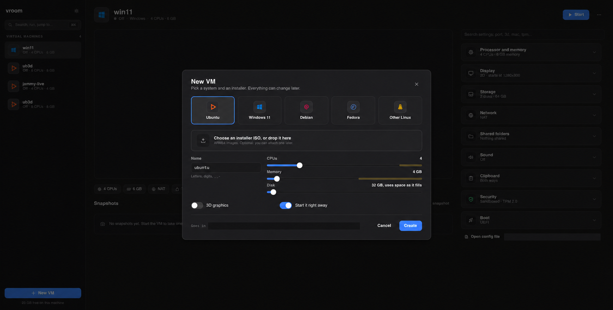

# Guide

## Prerequisites (macOS, Apple Silicon)

```bash
xcodebuild -downloadComponent MetalToolchain   # Xcode 26: separate download
brew install qemu meson ninja bison pkg-config llvm llvm@15 molten-vk lld uv
cargo install cargo-xwin
scripts/app.sh --install     # vroom.app, in /Applications
scripts/build.sh [--release] # just vroom + vroom-gui, into target/debug (target/release)
```

- Needs full Xcode (not just the command line tools) and rustup.
- qemu: only its UEFI firmware and qemu-img. The rest builds 3D and the guest tools.
- Metal toolchain: ANGLE compiles Metal shaders; Xcode 26 no longer ships `metal`. Check: `xcrun metal --version`.
- Mesa/virglrenderer code generators run on a pinned Python that uv fetches into `target/pyenv` (`scripts/pyenv.sh`), not PATH `python3`. Why: Homebrew python's `pyexpat` can be built against a newer libexpat than the `/usr/lib` one it loads; `python3 -m venv` then dies in `ensurepip`.
- `lld` and `llvm` must be the same version: Homebrew `lld` loads Homebrew `libLLVM`. `llvm` upgraded alone → `lld-link` aborts, cargo-xwin can't link the Windows agent. Fix: `brew upgrade lld`.

## The Mac app

`scripts/app.sh` → `target/dist.noindex/vroom.app`. `--install` copies it to `/Applications` (refused while VMs run from there). `--no-build`: package what `target/` has.

- Spotlight skips `.noindex`: it offers only the installed app.
- Contents: 3D (ANGLE, DXMT, virglrenderer), guest tools with Windows 3D drivers, virtio-win drivers, WinFsp, Secure Boot firmware. Pinned downloads: `scripts/fetch.sh` → `target/downloads/`.
- Long builds rerun only when their inputs change.
- Open a VM file with vroom (Open With, or drop on the Dock icon): starts it. Drop an ISO: New VM with it. Drop a `.vmwarevm`: import.
- Logs: `~/Library/Application Support/vroom/logs/` (`vroom-gui.log`; each VM's last run: `⋯` → Show log).
- `Contents/MacOS/vroom`: the VMM, all commands.
- Signed ad hoc: fine on the Mac that built it; other Macs block it until allowed in Privacy & Security. A rebuild may re-ask for camera and microphone.

## The app

`vroom-gui` with no arguments: the library.



| | |
|---|---|
| new VMs | `~/Library/Application Support/vroom/VMs/<name>/` (Linux: `~/.local/share/vroom/VMs/`), or the folder from "Change…" (New VM) / "Choose folder…" (VMware import), kept for next time |
| "Open…" `⌘O` | add a VM file from anywhere; it stays where it is |
| `⋯` → Rename… / Move to… | off or suspended. File, `.state` folder, own folder follow; disk files keep names; MACs unchanged. Move needs the VM in its own folder; to another disk: copy, then delete original |
| `⋯` → Clone… | off or suspended, own folder. Next to it or "Change…". APFS: instant, shared space; elsewhere: a copy |
| `⌘K` (Linux Ctrl+K) | commands and settings by name |
| `VROOM_HOME=dir` | another data dir |
| `VROOM_SHOT=out.png` | save a picture of the window, quit |

Clone:

- New MACs, serials, hardware UUID; starts from the disks as they are.
- Snapshots and saved memory stay with the original: a suspended VM's clone boots as after power loss.
- First start: the agent sets a hostname from the part of the new name that differs (`ubuntu-26.04-acme` from `ubuntu-26.04-template` → `acme`), new machine ID, SSH host keys (Windows: computer name, machine GUID; not the SID), restarts once.
- Port forwards unchanged: change them before running both.

Settings:

- Saved to the VM file at once, comments kept. Hand edits show within seconds.
- Running or suspended: hardware locked (hover the lock). Network, USB, clipboard rules change live.
- Hover anything: what it does, its key in the file. All options: [CONFIG.md](CONFIG.md).

### The VM window

- Top bar: name and state, pause, snapshot, suspend, power menu, Ctrl+Alt+Del (Windows); CPU use, 3D, network, USB, guest tools, Coherence, settings, full screen, VM list.
- Full screen: bar slides in from the top edge.
- With the agent: guest takes the window's size.
- Pointer: the guest's own (Linux: hardware cursor; Windows draws its own).

### Drag and drop

Needs the guest tools.

| | |
|---|---|
| Mac → guest | drop files/folders on the window. Windows, X11: real drop where you let go. Wayland: lands on the Desktop |
| guest → Mac | drag from Explorer, Windows desktop, GNOME Files (X11) into Finder. Copied on drop; taken names get a number. Not on Wayland, not from inside zips |

Names Windows can't take get `_`. Links inside folders skipped.

### Coherence

Each guest app as its own Mac window (VMware's Unity). Windows guests, or Linux on X11. Needs the guest tools.

- On: bar's window button or `Ctrl+Alt+Shift+C`.
- Bottom bar replaces the taskbar: Start, launcher field (part of a name, Enter), a button per window, Leave Coherence. Drag it to another Mac screen to move the guest screen there.
- `Cmd+W`: asks the guest app to close.
- Linux: X11 only (Ubuntu: "Ubuntu on Xorg" at login), EWMH window manager (GNOME, KDE, Xfce, Cinnamon, MATE), session helper running. GNOME top bar hidden by the tools' Shell extension (next login).
- Tiling tools (Amethyst, yabai): float `vroom`.

### When the app crashes, or a VM stops answering

Each VM is its own process.

- App crash: VM keeps running; restart vroom, its window comes back. 5 min without the app: VM suspends itself.
- "Isn't answering": Force power off (asks, kills after 3 s).

## Moving a VM from VMware

ARM64 VMs from VMware Fusion (or Workstation on ARM). VMware's files are only read.

```bash
vroom import "~/Virtual Machines.localized/Win11.vmwarevm" --dry-run
vroom import "~/Virtual Machines.localized/Win11.vmwarevm" --dir ~/VMs
```

App: "Import from VMware" in `⋯` or `⌘K`, or drop the `.vmwarevm`.

- Disks → qcow2 (used parts only). Snapshot chains, linked clones: flattened to current state.
- Carried over: CPUs, memory, shared folders, sound, TPM setting. Every NIC → NAT.
- ISOs left out: VMware's boot entries don't come along, a CD would boot before the disk. Attach after first boot.
- Before: shut down in VMware, quit it. Suspended VM: `--yes`, memory lost.
- No x86 VMs.
- Remove disk encryption first. TPM contents don't come along: have the BitLocker recovery key.
- Linux guests boot as is; remove `open-vm-tools` if you like.

### Windows guests from VMware

Boots (NVMe) without virtio drivers: no network, basic display, clock off by your time zone. Fix:

1. `scripts/app.sh --install` (app carries the tools with drivers).
2. Start the VM in the app, log in. After 90 s the guest tools button offers the tools as USB stick `VRTOOLS`. (Or attach `target/guest-tools/vroom-tools.img` as a disk: `readonly = true`, `format = "raw"`, `bus = "nvme"`.)
3. In Windows run `vroom-setup.cmd` from that drive (asks for admin): virtio drivers, agent, WinFsp for shared folders, clock fix.
4. Restart Windows. Window status says when the agent connects.
5. Remove the tools disk from the VM file if attached. Uninstall VMware Tools.

- Installed on SATA in VMware: may not boot from NVMe (INACCESSIBLE_BOOT_DEVICE). Not handled.
- Windows may ask to reactivate. `--keep-hardware-ids` keeps VMware's UUID and SMBIOS names (guest can then tell it was VMware).

## Guest tools

Agent: clipboard, resize with the window, UI scale, time sync, clean shutdown, drag and drop, Coherence, USB disks' files. Ready-made VMs have it. Built by `scripts/make-guest-tools.sh` (`app.sh` runs it). `vroom guest-tools info`: the app's version.

VM window's box icon:

| State | Click does |
|---|---|
| **Newer tools here** (dot) | agent installs them itself, no restart |
| **No agent after 90 s, or too old to update** | tools inserted as USB stick `VRTOOLS`, removed once the agent says hello |

- Linux: `sudo mount -o ro LABEL=VRTOOLS /mnt && sudo sh /mnt/linux/install-agent.sh` (works on a live ISO too).
- Windows: `vroom-setup` from the VRTOOLS drive.
- No USB (`[boot] type = "kernel"`): add `vroom-tools.img` as a disk.
- Linux: root systemd service + unprivileged session helper (clipboard via X11; Wayland via Xwayland). Windows: `VroomAgent` service + per-logon helper.

No guest network needed:

```bash
vroom guest exec <vm.toml | name> [-p] [-t secs] -- ipconfig /all   # exits with the command's code
vroom guest exec dev -- systemd-run --wait --pipe --collect sh -c '...'   # Linux: apt, Docker etc.
vroom guest push <vm> <file> <guest path>
vroom guest pull <vm> <guest path> <file or dir>                    # size, SHA-256 checked
vroom guest update-tools <vm>                                       # newer tools, no window
```

- `exec`: Windows cmd.exe as SYSTEM (`-p` PowerShell); Linux sh as root, inside the agent's sandbox (read-only system, Unix sockets only), hence `systemd-run` for apt, Docker and such.
- vroom-lab: `guest.exec`, `guest.upload`, `guest.download`, `guest.update_tools`.

## Ready-made VMs

New VM: comes up installed, with the tools, your user, optionally your SSH key (any `~/.ssh/*.pub`, with a port forward).

| OS | |
|---|---|
| **Ubuntu 24.04** | leave the installer empty: cloud image downloaded, checked, cached in `~/Library/Caches/vroom`. ~1 min; "Desktop" adds ~10 |
| **Windows 11 ARM64** | pick the ISO (microsoft.com). ~20 min, unattended. Then remove the install disk from the VM file, delete `install.img`. ISOs with a 4 GB+ image: `brew install wimlib` |

"Secure Boot" (`--secure-boot`): either OS, off by default.

```bash
VROOM_NEW_PASSWORD=... vroom new web --os ubuntu --ready --ssh-key ~/.ssh/id_ed25519.pub [--desktop] [--image noble.img]
VROOM_NEW_PASSWORD=... vroom new win --os windows --ready --iso Win11_ARM64.iso --ssh-key ~/.ssh/id_ed25519.pub
```

- `--dir`: where. `--user`: another user.
- Windows answer file holds the password in clear in `install.img`: delete it after.

## Ubuntu 24.04 (cloud image, direct kernel boot)

```bash
mkdir -p images/ubuntu && cd images/ubuntu
curl -L -o noble.img https://cloud-images.ubuntu.com/noble/current/noble-server-cloudimg-arm64.img
curl -L -o vmlinuz https://cloud-images.ubuntu.com/noble/current/unpacked/noble-server-cloudimg-arm64-vmlinuz-generic
curl -L -o initrd https://cloud-images.ubuntu.com/noble/current/unpacked/noble-server-cloudimg-arm64-initrd-generic
../../target/debug/vroom disk create disk.qcow2 --backing noble.img --size 20G
hdiutil makehybrid -iso -joliet -default-volume-name cidata -o seed.iso seeddir   # user-data, meta-data
cd ../.. && target/debug/vroom run examples/ubuntu.toml
```

- Guest tools: copy `target/guest-tools/linux/` in, `sudo sh install-agent.sh`.
- No RTC driver in the cloud image: wrong date until NTP or the agent. In `linux-modules-extra-$(uname -r)`.

## Ubuntu desktop (live ISO, UEFI)

```toml
name = "desktop"
cpus = 4
memory_mib = 6144
[boot]
type = "uefi"
vars = "desktop.state/efivars.fd"
[[disk]]
path = "ubuntu-24.04-desktop-arm64.iso"
readonly = true
cdrom = true
[display]
gpu = "virtio2d"
[[net]]
mode = "nat"
```

`vroom-gui desktop.toml`.

Ubuntu 22.04: repeated `tracker-extract-3` crash dialogs = harmless tracker bug: `systemctl --user mask tracker-extract-3`.

## Windows 11 ARM64

New VM does all this ([Ready-made VMs](#ready-made-vms)). By hand:

1. Get a Windows 11 ARM64 ISO.
2. `scripts/make-windows-stick.sh win11-arm64.iso winusb.raw`: FAT32/MBR install stick with drivers, unattend file, setup script, agent (an ISO can't boot Setup on NVMe).
3. Config:

   ```toml
   name = "win11"
   cpus = 4
   memory_mib = 6144
   [boot]
   type = "uefi"
   vars = "win11.state/efivars.fd"
   [[disk]]
   path = "win11.qcow2"        # vroom disk create win11.qcow2 --size 64G
   format = "qcow2"
   bus = "nvme"
   [[disk]]
   path = "winusb.raw"
   readonly = true
   format = "raw"
   bus = "nvme"
   [[net]]
   mode = "nat"
   ```

4. `vroom-gui win11.toml`. Setup wipes **disk 0**, logs in as `vroom`/`vroom` (change it), installs drivers and agent.
5. **Remove the stick from the config afterwards**: else a failed boot falls through to an unattended reinstall.
6. Add `[display] gpu = "virtio2d"`.

Agent upgrades: guest tools button ([Guest tools](#guest-tools)), or re-run `vroom-setup.cmd`.

## Several monitors

```toml
[display]
gpu = "virtio3d"     # or virtio2d
monitors = 2         # up to 4
```

- A window per monitor; the agent lines them up. Full screen spreads them over the Mac's screens.
- Closing a window turns that monitor off ("Show all displays" brings it back).
- Windows: one GPU per monitor, only the first does Direct3D. Needs viogpudo and viogpu3d installed. Before login only the first monitor has a pointer.
- One UI scale for all. Coherence: first monitor only.

## Retina screens

`[display] hidpi = true` (default): real pixels, 200% guest UI scale. Switchable live. Needs the current agent; GNOME and Windows only. Windows 2D driver tops out ~2560x1600 per monitor.

## 3D acceleration (Linux guests)

`[display] gpu = "virtio3d"`. Built by `scripts/app.sh` (alone: `scripts/build-angle.sh`, then `scripts/build-virglrenderer.sh`).

| | |
|---|---|
| **OpenGL** (virgl) | up to 4.1, on macOS's OpenGL |
| **Vulkan** (Venus) | 1.3. Needs `mesa-vulkan-drivers` (Mesa ≥ 24), user in `render`. Check: `vulkaninfo --summary` → `Virtio-GPU Venus`. Mesa 25.2 crashes on the Asahi driver: `install-agent.sh` disables it, or `VK_LOADER_DRIVERS_DISABLE='*asahi*'` |

| `opengl_host` | `apple` (default) | `angle` |
|---|---|---|
| Guest gets | OpenGL 4.1 | OpenGL 2.1, ES 3.0 |
| Notes | | stricter checks; GL 3+ apps fail, Chrome has no GPU |

- Stock Ubuntu works, 26.04 included; 26.04 needs virglrenderer patch 0018.
  - Cause: 26.04 GNOME blits a `BLOB_MEM_GUEST` blob (guest storage, no GL object) from the shell's context. Unpatched: `Illegal resource N` via `vrend_report_context_error`, which sets `in_error` on the context for good; every later command buffer refused, black desktop from the first frame.
  - Patch: skips a copy whose handles have no host object (those pixels missing or stale), logs it once.
  - Dead context anyway: the VMM names it and says to fall back to `gpu = "virtio2d"`.
- `opengl = false`: Vulkan only (smaller attack surface).
- Above GL 4.1: run the app on Zink (below), or `LIBGL_ALWAYS_SOFTWARE=1`.
- Snapshots, suspend: work with GL and Vulkan apps running. Not saved: multisampled buffers, query results. OpenGL blobs and leftover Vulkan window memory block the save. `VKR_SNAPSHOT_LOST=1`: drop Vulkan state on save (testing).
- `VROOM_NO_SURFACES=1`: no zero-copy display path.
- Processes: `vroom gpu-helper`, plus a `vroom gpu-worker` per Vulkan or Direct3D app ([SECURITY.md](SECURITY.md#the-gpu-process)). A crash costs 3D (or that app), not the VM. Windows desktop frozen after one: Win+Ctrl+Shift+B.

Numbers: [PERFORMANCE.md](PERFORMANCE.md).

### Chrome and Chromium

GPU-accelerated as is (`chrome://gpu`: "Hardware accelerated") with `opengl_host = "apple"`. Not on `angle`.

### OpenGL 4.4 for one app (Zink)

```bash
MESA_LOADER_DRIVER_OVERRIDE=zink glxinfo -B     # Xorg: also LIBGL_KOPPER_DRI2=1
```

- OpenGL 4.4, ES 3.1 on Venus.
- A bit slower than virgl for plain drawing: use for apps that need compute shaders.
- Transform feedback: only `glDrawArrays`. Packed 10-bit vertex formats read wrong.

## 3D in Windows guests (Direct3D 11)

Built by `scripts/app.sh` (DXMT = Direct3D 11 on Metal, plus the guest side).

In the guest, as admin, install `viogpu3d-arm64x-signed.zip` from [osy/kvm-guest-drivers-windows](https://github.com/osy/kvm-guest-drivers-windows/releases):

```bat
pnputil /add-driver viogpu3d.inf /install
```

Shut down, `[display] gpu = "virtio3d"`, start. Device Manager: "Red Hat VirtIO GPU 3D controller", feature level 11_1.

- Resize blinks the screen (driver needs a monitor replug).
- No Direct3D 12.
- Suspend, snapshots: work (current tools). Agent turns the 3D display off for the save. Apps keep running; 3D apps lose GPU state. Black screen after resume: suspend and resume again.

## OpenGL and Vulkan in Windows guests

In the guest tools (`scripts/app.sh`); `vroom-setup.cmd` installs them. Apps get Vulkan 1.3 (Venus), OpenGL 4.4 (Zink; virgl 4.1 fallback). ARM64 and x64 apps; not 32-bit.

- `GALLIUM_DRIVER=virgl`: virgl driver for one app.
- Suspend/snapshot: these apps lose their GPU (Vulkan: device lost; OpenGL: blank window until restarted).
- Logs: `VROOM_GL_LOG=C:\path\gl.log`; `MESA_LOG_LEVEL=debug`, `VN_DEBUG=init`.

## Video decoding

Linux guests, Mac hardware decoder.

```toml
[display]
video_decode = true
```

V4L2 decoder `/dev/video0`: H.264, HEVC (Main, Main 10), VP9 (0, 2), AV1 (M3+). Up to 4096x2304.

```bash
sudo sh install-virtio-media.sh    # scripts/guest/, builds with DKMS
v4l2-ctl --list-devices            # Video decoder (platform:virtio-media)
sudo usermod -aG video $USER       # log in again
gst-launch-1.0 filesrc location=movie.mp4 ! qtdemux ! h264parse ! v4l2h264dec ! autovideosink
ffmpeg -c:v h264_v4l2m2m -i movie.mp4 -f null -
```

- Up to 8 decoders. Survive snapshots (resume at the next key frame).
- FFmpeg 6.1's `v4l2m2m` decoders are flaky; GStreamer and VA-API fine.
- Sandboxed `vroom video-helper` ([SECURITY.md](SECURITY.md#video-decoding)).

### Browsers: VA-API

```bash
sudo sh install-vaapi.sh     # scripts/guest/, after virtio-media
vainfo                       # Driver version: vroom (VideoToolbox ...)
```

H.264, HEVC, VP9 (not AV1). Needs `gpu = "virtio3d"`. Log in again after.

| Browser | |
|---|---|
| Firefox (snap or deb) | works by default. Check `about:support` → HWDEC. YouTube sends AV1: `media.av1.enabled = false` |
| Chrome / Chromium | works by default with `opengl_host = "apple"`. Check `chrome://media-internals` → `VaapiVideoDecoder`. X11 needs `--render-node-override=/dev/dri/renderD128`: the script adds it (`google-chrome` wrapper in `/usr/local/bin`; `CHROMIUM_FLAGS` for the snap). WebRTC H.264, VP9 decode on the Mac too |

Re-run the script after it changes.

## Video encoding

```toml
[display]
video_encode = true
```

V4L2 encoder: NV12/P010 in, H.264 or HEVC out (no VP8/VP9/AV1). Same virtio-media driver as decoding.

```bash
ffmpeg -i in.mp4 -pix_fmt nv12 -c:v h264_v4l2m2m -b:v 4M out.mkv
ffmpeg -vaapi_device /dev/dri/renderD128 -i in.mp4 -vf 'format=nv12,hwupload' -c:v h264_vaapi -b:v 4M out.mp4
```

- Bitrate, CBR/VBR/CQ, GOP, profile. No B-frames. CBR = low latency (~5 ms a frame).
- VA-API HEVC rounds height to 16 (1080 → 1088); exact sizes: `hevc_v4l2m2m`.
- Chrome WebRTC encodes H.264 on the Mac (`--enable-features=AcceleratedVideoEncoder`, added by `install-vaapi.sh`). VP8/VP9 calls stay in software. Check `chrome://webrtc-internals` → `VaapiVideoEncodeAccelerator`.
- Up to 8 encoders; survive snapshots (a few frames lost).
- Sandboxed `vroom video-helper --encode` ([SECURITY.md](SECURITY.md#video-encoding)).

## Shared folders

```toml
[[share]]
path = "/Users/me/shared"
tag = "host"
readonly = false     # default true
```

Linux: `sudo mount -t virtiofs host /mnt` (fstab: `host /mnt virtiofs defaults 0 0`). Guest can't create symlinks, hard links, device nodes; existing symlinks not followed on the host.

Added while the VM runs or is suspended: there at once, and after each resume (Linux: `/media/vroom/<tag>`, mounted by the agent). A plain `[[share]]` from the next boot.

### Windows guests

- Drive letters from Z: down.
- `vroom-setup.cmd` installs the viofs driver, [WinFsp](https://winfsp.dev) (MSI on the tools disk, no internet needed), one `VroomShare_<tag>` service per share.
- Added or removed shares: after a reboot.
- No links; 259-character paths; case-insensitive on a Mac host.

Mount on a folder instead (must not exist yet):

```bat
sc config VroomShare_host binPath= "\"C:\Program Files\Vroom\virtiofs.exe\" -t host -m C:\Shares\host"
sc stop VroomShare_host & sc start VroomShare_host
```

## Network adapters

- Bar's network button, per adapter: plug/unplug cable, switch NAT / Bridged / Host-only live (same MAC, re-DHCP). Saved to the file.
- Settings: new adapters hot-plug on UEFI VMs. Port forwards, MAC changes, NAT on a VM started without it: next start.
- Details: [NETWORKING.md](NETWORKING.md#changing-adapters-while-the-vm-runs).

## USB devices

```bash
brew install libusb
vroom usb list
```

```toml
[[usb]]
id = "1209:000a"
```

- Bar's USB button: connect a Mac device for this run. "Always connect to this VM": saved to the file.
- Each device: own sandboxed `vroom usb-host` ([SECURITY.md](SECURITY.md#usb-devices)).
- Suspend and revert replug devices; run-only ones are handed back on suspend.

### Devices macOS uses

- HID, disks, audio, webcams, USB Ethernet, common serial chips: held by macOS drivers. Taking them needs the root helper: menu "Set up (asks for your password)".
- USB disks as raw device, macOS 15.3+: also Full Disk Access for `/usr/local/libexec/vroom/vroom-netd` (again after each update). Usually [USB disks](#usb-disks) is what you want.
- Device left taken by an older vroom: replug, or `vroom usb reset 18a5:0302`.

### USB disks

Clicking a disk asks:

| Choice | |
|---|---|
| **Share its files** | stays mounted on the Mac; guest sees a shared folder. No password |
| **Use as a disk** | guest gets the whole disk (admin password); Mac remounts it after. Close files on it first |
| **Pass the USB device** | needs Full Disk Access (above) |

- "Remember for this device": keeps the choice (`mode` in [CONFIG.md](CONFIG.md#usb-host-usb-devices-up-to-8)).
- Linux with agent: `/media/vroom/<volume>`. Without: `sudo mount -t virtiofs vroom-usb0 /mnt`.
- Windows: a drive letter, like shared folders.
- Two disks at a time. Mac hosts only. Suspend disconnects them.
- macOS may ask about removable volumes: Privacy & Security, Files & Folders.

Testing:

```bash
hdiutil attach -nomount disk.dmg
VROOM_USB_TEST_DISKS=disk6 vroom-gui
# vroom run: VROOM_USB_TEST_DISK=<file>, VROOM_USB_TEST_FILES=<dir> (VROOM_USB_TEST_AFTER, VROOM_USB_TEST_FOR)
```

### Limits

- Without the root helper: composite devices get only the functions macOS leaves alone.
- All transfer types, USB 1.1 to 3.x. No bulk streams (UAS falls back).
- Linux hosts: usbfs, needs a udev rule, e.g. `SUBSYSTEM=="usb", ATTR{idVendor}=="1209", ATTR{idProduct}=="000a", MODE="0660", TAG+="uaccess"`.
- Fake devices: `VROOM_USB_FAKE=acm|audio|disk|disk-broken`, `VROOM_USB_FAKE_UNPLUG=<secs>`.

## The root helper (vroom-netd)

Root needed for bridged/host-only networking and for taking USB devices from macOS drivers. Only vroom-netd runs as root ([SECURITY.md](SECURITY.md#the-root-helper-vroom-netd)).

- App: "Set up (asks for your password)" where needed, or `⌘K` → "Set up vroom-netd" / "Remove vroom-netd".
- Log: `/var/log/vroom-netd.log`.

By hand:

```bash
sudo mkdir -p /usr/local/libexec/vroom /etc/vroom
sudo install -o root -g wheel -m 755 target/release/vroom-netd /usr/local/libexec/vroom/
sudo install -o root -g wheel -m 644 "$(realpath /opt/homebrew/lib/libusb-1.0.0.dylib)" \
    /usr/local/libexec/vroom/libusb-1.0.0.dylib
sudo install -o root -g wheel -m 644 packaging/netd.toml /etc/vroom/
sudo install -o root -g wheel -m 644 packaging/org.vroom.netd.plist /Library/LaunchDaemons/
sudo launchctl bootstrap system /Library/LaunchDaemons/org.vroom.netd.plist
sudo launchctl kickstart -k system/org.vroom.netd       # restart

# remove
sudo launchctl bootout system/org.vroom.netd
sudo rm -rf /Library/LaunchDaemons/org.vroom.netd.plist /usr/local/libexec/vroom /etc/vroom
```

`/etc/vroom/netd.toml`:

| Key | Default |
|---|---|
| `group` (networking) | `staff` |
| `[usb] group` | `admin` |
| `[usb] enabled` | |
| `bridge_interfaces` | `["en*"]` |
| `[[host_only]]` | `lab`, 192.168.77.1/24 ([NETWORKING.md](NETWORKING.md#host-only)) |

Linux: `packaging/vroom-netd.service`, group `vroom`.

## Sound

```toml
[audio]
output = true
input = true     # microphone, off by default
```

- Windows: Intel HD Audio, inbox driver.
- Linux: virtio-snd (cloud images: `linux-modules-extra-$(uname -r)`), or `device = "hda"`.
- Linux hosts: ALSA, needs a glibc build.
- Testing: `VROOM_AUDIO_WAV_DIR=dir` writes `audio.wav`, feeds `mic.wav`.

### Microphone

- Live only while the VM's window is open, the VM runs, and the guest records. Bar shows "Microphone in use".
- macOS asks permission for the app that started vroom (vroom, or your terminal). Denied: window says so; fix in Privacy & Security → Microphone, or `tccutil reset Microphone org.vroom.app`.
- Follows the Mac's default input.

## Camera

`camera = true`: standard USB webcam fed by the Mac's camera.

- Same gating and permission rules as the microphone.
- 640x480, 1280x720 or 320x240, at 30 or 15 fps.
- Testing: `VROOM_CAMERA_TEST=1` sends color bars.

## Snapshots, suspend

| | |
|---|---|
| snapshot | `Ctrl-A s` / `Ctrl+Alt+Shift+S` → `<state>/snapshots/snap-<time>` |
| revert | `vroom run vm.toml --restore <state>/snapshots/snap-…` |
| suspend | `Ctrl-A z` / `Ctrl+Alt+Shift+Z` / close the window. Next `run` resumes; `--fresh` ignores it |
| manage | `vroom snapshot list\|delete\|prune vm.toml` (VM stopped); delete also drops and merges unused disk layers |

A snapshot's disk layers go read-only. Restoring one whose layers changed since (another program wrote one) is refused: it would corrupt the guest's disk.

## Moving a VM

- Stop it, move its folder anywhere (another disk too), add it from there: drop its `.toml` on vroom.
- Inside the folder everything is relative to it (disk layers, snapshots, suspend image). A disk outside it keeps its path.
- Copy with Finder or `cp -p`: snapshots check layer mtimes.
- VMs from older builds: `scripts/relative-paths.py` once (dry run; `--apply`; `--undo LOG`; default: all VMs in the library).

## Disks

- <2 GiB free in the state dir: VM pauses. Free space, resume (`Ctrl-A p`).
- TRIM gives space back. `vroom disk compact vm.qcow2` (VM off) shrinks the file.
- `sync`: `"fsync"` (default, survives host crash), `"full"` (survives power loss, slow), `"none"` (scratch only).

### Read-only disks

`readonly = true`: nothing the guest does changes the image.

- Linux: sees it read-only on virtio and NVMe.
- Windows: sees it on virtio ("write protected"), not on NVMe: mounts read-write, writes fail at flush (Setup copes). Use `bus = "virtio"` once the drivers are in.

## Known limitations

- x86_64 hosts build but can't run VMs.
- Bridged tested on vmnet (Wi-Fi), host-only on vmnet (Windows guests). tap and netd's DHCP (Linux) untested on a real host.
- Windows 11 installs with hardware checks bypassed, in case there's no TPM or Secure Boot. Real TPM 2.0: `tpm = true` (`brew install swtpm`). Secure Boot: `[boot] secure_boot = true`.
- Windows 3D: Direct3D 11 only.
- NAT connections don't survive suspend.
- Nested: no Hyper-V in Windows guests (WSL 2, Docker Desktop, Windows Sandbox). Hypervisor.framework's EL2 has no VHE; Hyper-V on Arm needs it. Windows boots without Hyper-V.
- USB: tested with fake devices; real USB sticks via vroom-netd with Full Disk Access untested.
